# BM-serie

Modulaire balenpers: Basismachine (BMM)

[EN](bmm-manual-en) - [DE](bmm-manual-de) - [FR](bmm-manual-fr) - [NL](bmm-manual-nl)

# Gebruikershandleiding

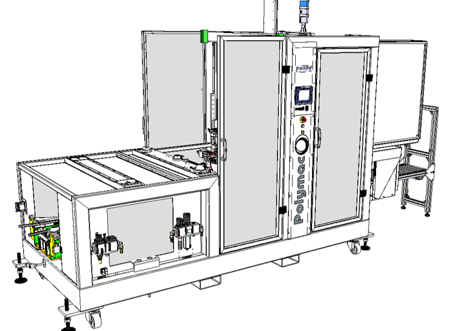

Het betreft de volgende artikelen

1. A275472 BMM
1. A276653 MH-BMF
1. A276045 MH-PBSB

# Inleiding

## Gebruikershandleiding

Beste gebruiker,

Deze handleiding biedt informatie voor eenvoudig gebruik en voor uw veiligheid en die van uw werkomgeving. Lees deze handleiding zorgvuldig door, zodat u grondig bekend raakt met de inhoud en de instructies opvolgt om de machine efficiënt, veilig en correct te kunnen bedienen en onderhouden.

- De aansprakelijkheid voor schade en/of ongevallen veroorzaakt door het niet opvolgen van de aanwijzingen en instructies berust bij u.
- Bewaar deze gebruikershandleiding voor toekomstig gebruik.
- Als u na het lezen van deze handleiding vragen heeft, neem dan contact met ons op via de onderstaande contactgegevens.

In deze handleiding worden de volgende pictogrammen gebruikt om de aandacht te vestigen op veiligheidskwesties die speciale aandacht vereisen. Volg de instructies zorgvuldig op.

> Waarschuwing: Extra aandacht is vereist voor uw veiligheid

### Contactgegevens

Houd het machinetype en serienummer bij de hand voordat u contact met ons opneemt. Deze informatie staat op het typeplaatje op de schakelkast.

Polymac b.v.  
Morsestraat 20, 6716 AH EDE (NL)

Tel: +31(0)318 - 64 86 00
Internet: www.pagesgroup.net
e-mail: info@polymac.pagesgroup.net

## Garantievoorwaarden

De garantie van de machine komt te vervallen als:

- De machine wordt blootgesteld aan enig misbruik, verkeerd gebruik of verwaarlozing of als deze wordt gebruikt op een manier die niet in overeenstemming is met het beoogde doel;
- Originele onderdelen, zoals aangegeven in Hoofdstuk 14 van deze handleiding, niet worden gebruikt;
- Andere smeermiddelen dan de gespecificeerde worden gebruikt;
- Wijzigingen aan de machine worden aangebracht zonder voorafgaand schriftelijk overleg met Polymac BV;
- Bediening, onderhoud en reparatie niet worden uitgevoerd volgens de instructies in deze handleiding.

## Copyright

Niets uit deze handleiding mag worden gekopieerd of gereproduceerd zonder schriftelijke toestemming van Polymac BV.

# Transport, uitpakken, opstellen

## Transport

> Waarschuwing: Voor modellen met zwenkwielen: wanneer u de machine in de vrachtwagen plaatst, draait u de stelpoten tegen de klok in om de zwenkwielen vrij te geven en zet u de machine vervolgens vast om beweging tijdens transport te voorkomen.

### Laden en lossen

Een heftruck (met een minimale draagkracht van 3000 kg) kan worden gebruikt voor het laden en lossen van de machine. Het frame is voorzien van sleuven voor de heftruckvorken tijdens het laden en lossen. Het zwaartepunt van de machine ligt tussen de twee sleuven. Zie het hoofdstuk Specificaties voor het gewicht van de machine.

> Info: de machine kan worden uitgerust met hijsogen die speciaal zijn ontworpen om de machine gemakkelijk in positie te manoeuvreren.

> Waarschuwing: Gebruik indien mogelijk een heftruck om de machine als geheel te verplaatsen. Als de machine met een hijskraanbaan moet worden opgetild en verplaatst, gebruik dan hijsogen met de volgende specificaties: M16, WLL 700 kg, CE-gemarkeerd. Zorg ervoor dat de belasting die op de ogen drukt verticaal wordt verdeeld: gebruik een hijsbalk om zijdelingse krachten te voorkomen.

### Controle op schade aan machine en componenten

Controleer vóór het lossen of er tijdens het transport schade is ontstaan.

### Procedure voor het controleren van schade aan de machine en/of componenten

In geval van schade moet een door de vervoerder ondertekend claimformulier bij Polymac BV worden ingediend. Als de geleverde machine en/of componenten na het uitpakken in beschadigde staat verkeren, neem dan contact met ons op.

## Uitpakken

Alle Polymac-machines worden met de nodige zorg en aandacht verpakt om ervoor te zorgen dat er geen schade of defecten optreden.

Uitpakken:

1. Verwijder het bubbeltjesplastic van de hoofdschakelkast, het functieselectiepaneel, de afschermingen en andere delen van de machine.
1. Veeg overtollig CRC SP 400 Soft Seal corrosiewerend middel van de metalen delen met een schone, droge doek.

Controleer of de uitgepakte onderdelen onbeschadigd zijn. Zo niet, zie 2.1.3.

## Opstellen

### Voorwaarden voor opstelling

De machine moet op een vlakke en horizontale ondergrond worden geplaatst; er is geen speciaal fundament nodig. Als de machine is uitgerust met zwenkwielen, moet deze op de stelpoten rusten, niet op de zwenkwielen. De zwenkwielen zijn alleen nodig om de machine gemakkelijk en snel van de ene naar de andere locatie te verplaatsen. Zorg ervoor dat de machine waterpas op een vlakke ondergrond staat.

### Aansluitklemmen op locatie

De volgende aansluitklemmen moeten aanwezig zijn op de installatielocatie:

- Stopcontact (230/400V 50 Hz 32A)
    De machine is uitgerust met een 5-polige CEE 32A-stekker
- Persluchttoevoersysteem 8 bar 1100 l/min.
    Versterkte slang Ø 16x22 voor een werkdruk van 8-10 bar (minimaal 6 bar). Deze wordt aangesloten op een Ø 16-slanguitsparing. Persluchtreinheid conform ISO 8573-1:2010 (7:4:4)

## Installatie

### Door Polymac B.V.

Zorg ervoor dat aan alle voorwaarden en vereisten (zoals aansluitklemmen) die in de voorgaande paragrafen zijn beschreven, is voldaan voordat onze technicus de machine installeert.

### Installatie door de klant

- Polymac hengselvorm- en montagemachines kunnen ook door de klant worden geïnstalleerd en in bedrijf worden gesteld.
- Gezien het hoge risico op fouten en de daaruit voortvloeiende gevaren bij het installeren van machines die in combinatie met een spuitgietmachine moeten worden opgesteld, mogen deze echter niet door de klant worden geïnstalleerd of in bedrijf gesteld.

De machine mag echter wel op de werkplek worden geplaatst. Een Polymac-servicetechnicus zal de machine installeren, uitlijnen en in bedrijf stellen. De toewijzing van verantwoordelijkheid voor het installeren en in bedrijf stellen van deze machine wordt hieronder beschreven.

> Waarschuwing: Deze machine mag door de klant worden geïnstalleerd en in bedrijf gesteld. Dit gebeurt echter op risico en verantwoordelijkheid van de klant en leidt tot het vervallen van de garantie voor schade die de machine als gevolg van de installatie oploopt.

# Beoogd gebruik en voorwaarden

## Beoogd gebruik

De basismachine maakt deel uit van het modulaire balenpersconcept. Deze basis is in combinatie met een module ontworpen voor een specifieke toepassing, namelijk het vormen van hengsels (metaal/kunststof) en het bevestigen van deze hengsels op kunststof emmers (zie 4.5.4 voor productspecificaties) en het stapelen daarvan.

Gebruik van de machine voor andere doeleinden kan gevaarlijke situaties veroorzaken of een onjuiste werking van de machine tot gevolg hebben. In dergelijke gevallen adviseren wij u contact op te nemen met Polymac.

## Wijzigingen

Wijzigingen die zonder toestemming van Polymac worden uitgevoerd, doen de EG-verklaring van overeenstemming vervallen.

## Gekwalificeerd personeel

Correct gebruik van een Polymac-machine vereist geschoold personeel.

- Bedienend personeel: bedieningstraining door Polymac + lezen en begrijpen van de bedieningsinstructies.
- Onderhoudspersoneel: onderhoudstraining door Polymac, lezen en begrijpen van de bedieningsinstructies, technicus op niveau van middelbaar beroepsonderwijs.

# Beschrijving

## Typeplaatje

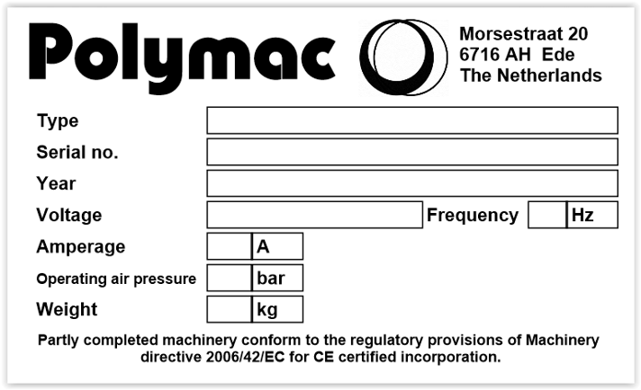

Het typeplaatje bevindt zich op de elektrische kast.

## Explosietekening van machine en hoofdcomponenten

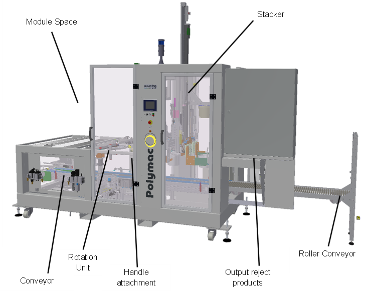

## Werkplekken en bedieningsgebieden

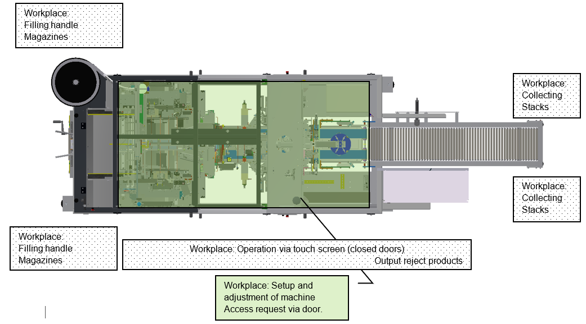

*weergave met MH-BMF-module

## Werking van de machine

De Polymac-basismachine is ontworpen om hengsels op een kunststof emmer te monteren. Het gemonteerde product wordt gecontroleerd en gestapeld.

Kunststof emmers worden via een transportband in de machine gevoerd. De emmers bewegen één voor één de machine in en worden correct gepositioneerd voor montage. Het gevormde hengsel wordt in positie gebracht voor montage en aan de emmer bevestigd. De correcte bevestiging wordt gecontroleerd; onjuist gemonteerde producten verlaten de machine via een aparte uitgang. Correcte producten worden gestapeld en complete stapels verlaten de machine via een rollenbaan.

Het vormen van de hengsels (metaal/kunststof) gebeurt in de module die apart wordt geleverd.

### Schema van de machine

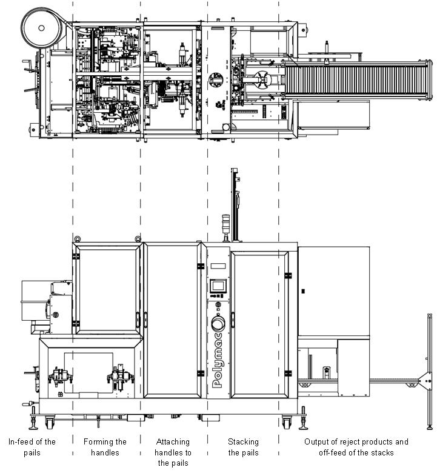

*weergave met MH-BMF-module

## Machinespecificaties

### Afmetingen

- Machine: Polymac Basismachine
- Type: BMM
- Bouwjaar: 2026
- Ethernet: Ja
- Bandhoogte vanaf de grond (doorvoer): Afhankelijk van product
- Vloeroppervlak (zonder rollenbaan): 3900 x 1500 mm
- Maximale machinehoogte: 3000 mm
- Uitvoerrollenbaan: 1500 mm links afgehoekt

### Opties

Opties instellen

### Technische specificaties

Cyclustijd: tot ± 3,8 sec (afhankelijk van module en product)
Spanning/frequentie: 230-400V / 50Hz
Geluidniveau: 75 dB(A), piek 88 dB(A) bij persluchtuitlaat van pneumatische apparatuur*
Gewicht basismachine: ± 1400 kg
Gewicht met MH-BMF-module: ± 2150 kg
Pneumatische aansluiting: Minimaal 6 bar (maximaal 10 bar)
Besturing: PLC-besturing
Bedrijfstemperatuur: 10°C - 40°C

### Te verwerken producten

Type
Productvorm
Buitenafmetingen
Hoogte
Hengselvorm
Draaddiameter
Draadlengte

# Plaatsen en uitwisselen van modules - Hijsinstructies

## Inleiding

Om de machine stapels emmers met bevestigde hengsels te laten produceren, moet een module bovenop de basismachine (BMM) worden geplaatst. Momenteel zijn er vier soorten modules beschikbaar:

- MH-BMF: Module voor het vormen en presenteren van metalen draden
- MH-PBS: Module voor het vormen en presenteren van platte kunststof hengsels
- MH-PBSB: Module voor het presenteren van voorgevormde kunststof hengsels
- MH-PBM: Module voor het snijden en vormen van kunststof hengsels uit een mat en het presenteren daarvan.

Hieronder volgt de procedure voor het plaatsen en verwijderen van de module op de basismachine BMM.

Lees deze instructies zorgvuldig door!

## Essentiële hijsvoorschriften

> Waarschuwing:
Waarschuwing
1. Het hijsen en plaatsen van de module mag alleen worden uitgevoerd door getraind en gekwalificeerd personeel.
2. Personeel moet de voorgeschreven persoonlijke veiligheidskleding dragen en de in dit document beschreven hijsprocedure naleven.
3. Omstanders die niet bij het hijsen betrokken zijn, moeten in de voorgeschreven veiligheidszones blijven, d.w.z. ten minste 5 m van het hijsgebied.
4. Er mogen zich geen personen onder de module bevinden terwijl deze wordt opgetild of gehesen!

## Plaatsen van de module - voorbereidingen

1. Zorg ervoor dat er voldoende ruimte rond de machine is voor het hijsen en plaatsen van de module.
1. Zorg ervoor dat het gebied rond de machine schoon en vrij van afval is om struikelen te voorkomen.
1. Zorg ervoor dat de basismachine uitgeschakeld is.
1. Controleer of de vier hijsbouten bovenop de module aanwezig en correct vastgedraaid zijn.
1. Gebruik een hijsketting, bij voorkeur een kettingstroppen met vier verstelbare benen, die het gewicht van de module kan dragen. (Zie het typeplaatje van de module voor het modulegewicht)
1. Pas de lengte van de benen aan op het zwaartepunt van de module. (Om ervoor te zorgen dat de module horizontaal blijft tijdens het hijsen).
1. Bevestig de kettingstroppen aan de vier hijsbouten.

## Plaatsen van de module - hijsen

1. Hijs de module met een lage snelheid.
1. Controleer of deze horizontaal blijft. Zo niet, pas de lengte van de benen van de kettingstroppen aan.
1. Er zijn twee personen nodig om de module naar de basismachine te begeleiden.
> Waarschuwing: Gebruik de grepen op de module voor het begeleiden. Plaats uw handen niet onder het frame van de module!
1. Breng de module naar de basismachine en lijn deze uit met de groene geleidestrips (zie onderstaande afbeelding).
1. Duw de module in de geleidestrips.
1. Laat de module langzaam zakken. Gebruik de grepen op de module om de module naar de positioneringskegels te begeleiden. **Plaats nooit uw handen onder de module!**
1. Laat de module verder zakken tot deze op de positioneringskegels rust.
1. Maak de kettingstroppen los van de module.

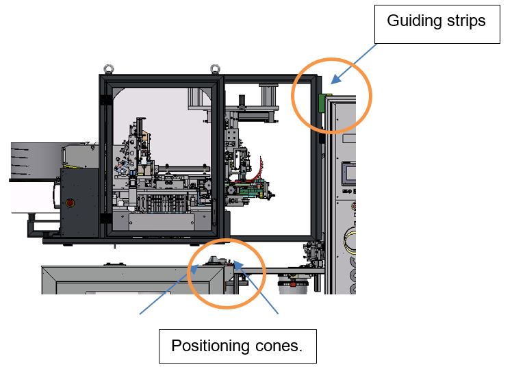

*weergave met MH-BMF-module

## Plaatsen van de module - bevestigen

1. Bevestig de bouten op de vier hoeken van de module. Eén bout per hoek.
    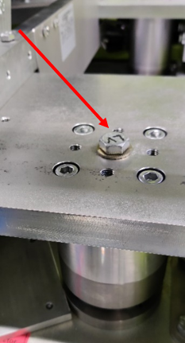
1. Bevestig de stekkers en de pneumatische koppeling.
    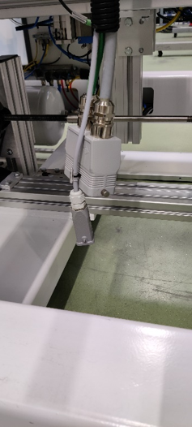
    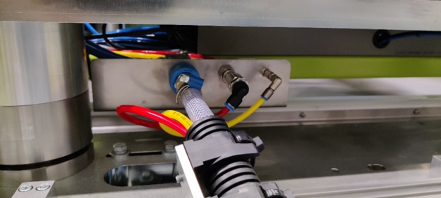
1. Indien nodig: Bevestig de productafhankelijke onderdelen in de basismachine:
    1. Centreerschijf
    1. Grijperplaat op de verticale hengselgrijper
    1. Hengselbevestigingsplaat
    1. Earblock-steunen
    1. Stapelklinken.
1. Sluit de deuren.

Hierna is de machine klaar voor gebruik.

## Verwijderen van de module - voorbereidingen

1. Zorg ervoor dat er voldoende ruimte rond de machine is voor het hijsen en plaatsen van de module.
1. Zorg ervoor dat het gebied rond de machine schoon en vrij van afval is om struikelen te voorkomen.
1. Zorg ervoor dat de basismachine uitgeschakeld is.
1. Koppel de elektrische stekkers tussen de module en de basismachine los.
1. Doe hetzelfde voor de pneumatische koppelingen.
1. Duw de horizontale hengselgrijper naar binnen tegen de eindstop. Zorg ervoor dat de transportbeveiliging van de hengselgrijper vergrendelt. Zie onderstaande voorbeelden.
    
    
1. Draai de vier maal vier bouten los waarmee de module op de basismachine is bevestigd.
1. Controleer of de vier hijsbouten bovenop de module aanwezig en correct vastgedraaid zijn.
1. Gebruik een hijsketting, bij voorkeur een kettingstroppen met vier verstelbare benen, die het gewicht van de module kan dragen. (Zie het typeplaatje van de module voor het modulegewicht)
1. Pas de lengte van de benen aan op het zwaartepunt van de module. (Om ervoor te zorgen dat de module horizontaal blijft tijdens het hijsen).
1. Bevestig de kettingstroppen aan de vier hijsbouten.

## Verwijderen van de module - hijsen

1. Hijs de module met een lage snelheid.
1. Controleer of deze horizontaal blijft. Zo niet, pas de lengte van de benen van de kettingstroppen aan.
1. Er zijn twee personen nodig om de module van de basismachine weg te begeleiden.
    > Waarschuwing:
    1. Gebruik de grepen op de module voor het begeleiden.
    1. Plaats uw handen niet onder het frame van de module!
    1. Sta, zit, kruip of bevind u op geen enkele andere manier onder de module tijdens het hijsen!
1. Breng de module naar de plaatsingslocatie, bijvoorbeeld een pallet.
1. Laat de module langzaam zakken. Gebruik de grepen op de module om deze naar de plaatsingslocatie te begeleiden. Plaats nooit uw handen onder de module!
1. Laat de module verder zakken tot deze op de steunpoten rust. Zorg ervoor dat de module niet op de positioneringskegels rust!
1. Maak de kettingstroppen los van de module.

# Veiligheid

## Veiligheidsfilosofie

Polymac BV voldoet aan de veiligheidsstrategie die in de Machinerichtlijn is vastgelegd voor het verminderen van risico's. Dit betekent: elimineer of verminder risico's zoveel mogelijk door inherent veilig ontwerp. In het laatste geval blijven er restrisico's over en de belangrijkste daarvan zijn in deze handleiding uiteengezet en weergegeven via gevarenpictogrammen op de machine.

De machine bestaat uit bewegende delen die door de vereiste verwerkingssnelheden en de bijbehorende versnellings- en massatraagheidskrachten niet inherent veilig zijn ontworpen. Daarom is de machine voorzien van een afscherming eromheen, met extra veiligheidsvoorzieningen bij de vereiste openingen.

## EG-verklaring van inbouw voor gedeeltelijk voltooide machines

### Basis

De machine valt binnen het toepassingsgebied van de Europese productrichtlijnen voor machines, laagspanning en elektromagnetische compatibiliteit. Omdat het een gedeeltelijk voltooide machine betreft, heeft deze geen CE-markering. De inhoud van de EG-verklaring van inbouw is vermeld in hoofdstuk 15.

De gedeeltelijk voltooide machine mag pas in bedrijf worden gesteld nadat is vastgesteld dat de machine waarin de gedeeltelijk voltooide machine moet worden ingebouwd, voldoet aan de bepalingen van de Machinerichtlijn (2006/42/EG).

### Modules

De module valt binnen het toepassingsgebied van de Europese productrichtlijnen voor machines, laagspanning en elektromagnetische compatibiliteit. Deze is geclassificeerd als "verwisselbare uitrusting", omdat deze bedoeld is om door de bediener zelf te worden gemonteerd om de modulaire basismachine een nieuwe functie te geven. Omdat het verwisselbare uitrusting betreft, heeft deze een CE-markering. De inhoud van de EG-verklaring van overeenstemming is vermeld in hoofdstuk Fout! Verwijzingsbron niet gevonden.
Deze module mag alleen op een specifiek type basismachine worden gemonteerd. Het onderdeelnummer/serienummer van deze basismachine, evenals de onderdeelnummers van de bijbehorende modules, zijn vermeld in de algemene EG-verklaring die voor deze installatie is afgegeven.

## Veiligheidsmaatregelen en -voorzieningen

### Veiligheidsvoorzieningen bij de uitvoeropeningen

1. *Productinvoer*
    Dit is de opening waardoor de emmer de machine binnengaat. Vanwege de vereiste afmetingen voor de emmer bestaat er een (verwaarloosbaar) risico dat deze opening wordt gebruikt als toegangspunt tot de machine vanaf de transportbandzijde. De aangrenzende deur dient echter als toegangspunt.
1. *Uitvoer van stapel eindproduct*
    Dit is de opening waardoor eindproducten (stapels emmers) worden uitgedragen. Vanwege de vereiste afmetingen voor de stapels bestaat er een (verwaarloosbaar) risico dat deze opening wordt gebruikt als toegangspunt tot de machine vanaf de transportbandzijde. De aangrenzende deur dient echter als toegangspunt.

Aanvullende veiligheidsvoorzieningen (bijv. poort, lichtgordijn) zijn overwogen, maar onpraktisch geacht en het is onwaarschijnlijk dat ze een significante veiligheidsverhoging opleveren.

### Toegangscontrolesysteem

De toegangsdeuren worden bewaakt door een veiligheidscontact dat is aangesloten op een veiligheidsmodule. De deuren openen wanneer een toegangsverzoek wordt geïnitieerd door op de knop 'Deur openen' te drukken. De knop is voorzien van een LED die knippert wanneer het verzoek wordt gedaan, waardoor de controller de machine in veilige modus brengt. Wanneer de machine in veilige modus is, blijft de LED branden en mag de deur worden geopend. De veilige modus wordt automatisch beëindigd wanneer de deur wordt gesloten en de drukknop opnieuw wordt ingedrukt. Als de deur wordt geopend zonder toestemming van het toegangscontrolesysteem, treedt een noodstop op.

### Bescherming aan de bovenzijde

De bovenzijde van de machine is open. De hoogte van de machine en de reikwijdte naar de bewegende delen zijn voldoende om het risico te elimineren (in overeenstemming met EN ISO 13857).

### Bescherming van de schakelkast

De elektrische kast kan alleen worden geopend wanneer de hoofdschakelaar op '0' staat. De deur kan worden ontgrendeld met een speciale sleutel. Kasten met stroom kunnen worden geopend met de speciale sleutel.

### Loskoppelen van de energiebronnen

Om alle energiebronnen los te koppelen:

1. Schakel de persluchttoevoer uit door de hoofdklep te sluiten.
1. Zet de hoofdschakelaar van de schakelkast op 0 en vergrendel deze met een hangslot.

## Pictogrammen

De volgende pictogrammen zijn op de machine aangebracht:

- **Geeft aan**: risico op verstrengeling in bewegende delen, over het algemeen in de behuizing bij in- en uitvoeropeningen. Betreed de machine via de toegangsdeuren; nader de machine niet van buitenaf.
- **Locatie**: op polycarbonaat bij transportband, uitvoer afgekeurd product, boven invoertransportband, onder draadmagazijn

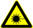
- Geeft aan: risico op blootstelling aan straling van de lasersensoren in de machine. De sensoren zijn categorie 1-sensoren en kunnen de ogen niet beschadigen; vermijd echter oogcontact zoveel mogelijk.
- Locatie: op positioneringseenheid zichtbaar door deur

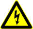
- Geeft aan: risico op elektrische spanning; contact met spanningvoerende delen kan fataal zijn. Alleen gekwalificeerd personeel mag aan de elektrische apparatuur werken.
- Locatie: op de elektrische kast, motor van hydraulische unit

- Geeft aan: verbod op betreden, in dit geval op de uitvoertransportband voor producten. Betreden kan valgevaar opleveren evenals toegang tot/reiken in openingen in de behuizing.

- Geeft aan: risico op roterende delen, in dit geval de uitvoertransportband. Beknellingsgevaar, verwijder de beschermkap niet.
- Locatie: op de invoertransportband

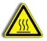
- Geeft aan: risico op hoge temperaturen, in dit geval de servomotoren.

- Geeft aan: toegang verboden
- Locatie: op polycarbonaat scherm parallel aan rollenbaan, op scherm boven invoertransportband

## Beveiliging

Om ervoor te zorgen dat onderhoud veilig kan worden uitgevoerd, moet de machine worden beveiligd. Dit omvat:

1. loskoppelen van de energiebronnen (5.3.5); stoppen van de machine met de start/stop-knop.
1. afvoeren van de aanwezige energie; loskoppelen van de luchttoevoer via de hoofdklep.
1. drukontlasting van de luchttank door de luchtafvoerkraan aan de onderkant van de tank te bedienen.
1. beveiligen tegen ongeoorloofde activering: zet de hoofdschakelaar op 0 en vergrendel deze met een hangslot.

## Restrisico's

De machine is zo veilig mogelijk ontworpen. Er blijven echter enkele risico's die gevaar kunnen opleveren tijdens het gebruik van de machine. Deze plaatsen zijn gemarkeerd met pictogrammen en worden hieronder weergegeven.

Restrisico aan invoerzijde (weergave met MH-BMF-module):

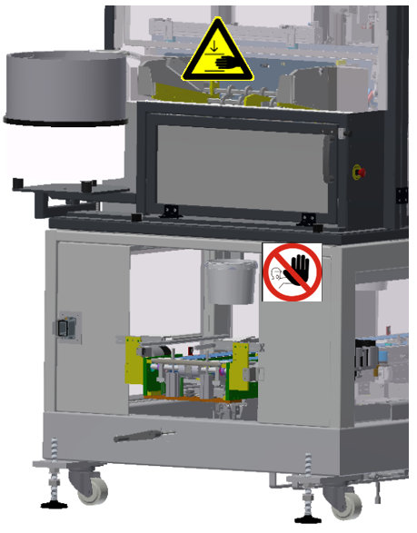

Restrisico aan uitvoerzijde:

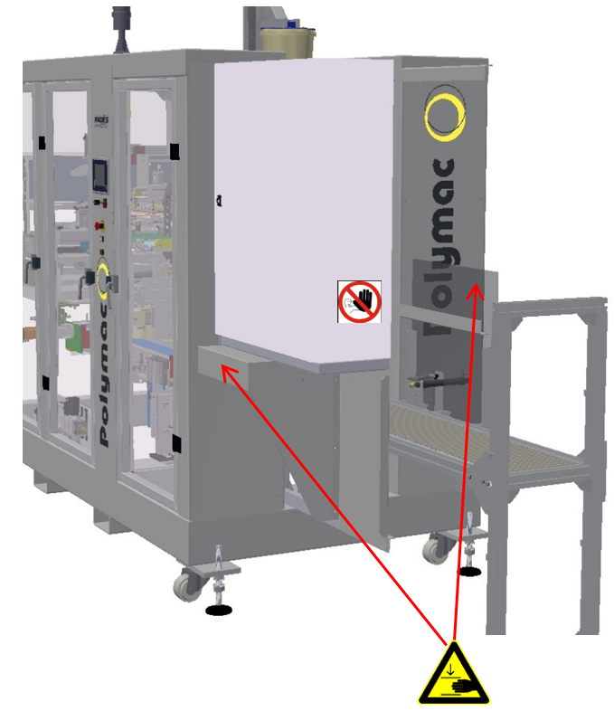

## Noodstopsysteem

Het noodstopsysteem is ontworpen om acute gevaarlijke situaties af te wenden en is een vereiste volgens de veiligheidswetgeving. Het noodstopsysteem kan ook worden gebruikt als er een dreigend risico op machineschade is.

De noodstopknoppen op de basismachine bevinden zich zoals weergegeven in de onderstaande afbeelding; raadpleeg de handleiding van de module voor aanvullende informatie.

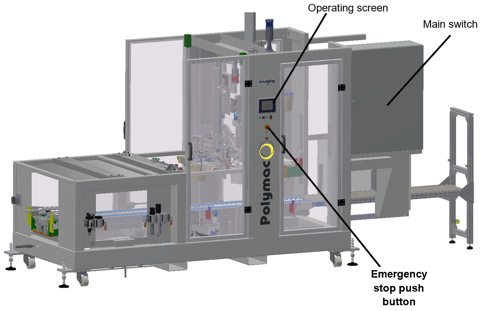

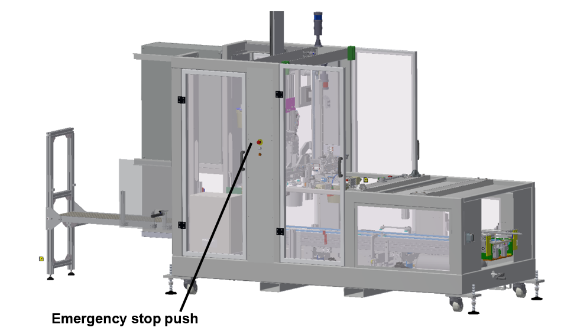

## Arbovoorschriften ter voorkoming van ongevallen

1. Volg de hijsinstructies in hoofdstuk 5 bij het vervangen van de module.
1. Er mogen zich geen personen onder de module bevinden terwijl deze wordt opgetild of gehesen!
1. Gebruik de handgrepen bij het manoeuvreren van de module in positie.
1. Houd de machine en de werkomgeving schoon en opgeruimd.
1. Zorg voor goede verlichting op de werkplek.
1. Gebruik geschikt gereedschap voor reparatie en onderhoud.
1. Laat veiligheidsvoorzieningen altijd ingeschakeld.
1. Verwijder geen vaste afschermingen (panelen en ruiten).
1. Vervang defecte onderdelen of veiligheidsvoorzieningen onmiddellijk.
1. Controleer periodiek het correcte gebruik van veiligheidsvoorzieningen.
1. Raak geen spanningvoerende delen aan met een defecte afscherming. Vervang onmiddellijk. NEN 3140 of Europese versie.
1. Vermijd vloeistoffen of metalen in de buurt van spanningvoerende delen.
1. Controleer of spanningvoerende kabels niet beschadigd zijn als gevolg van trekken, buigen, wrijving door beweging of het plaatsen van (zware) voorwerpen op de kabels.
1. Onderhoud is per definitie een hoogrisicoactiviteit. Beveilig de machine altijd en werk volgens de instructies in deze handleiding.
1. Verwijder geen gevarenpictogrammen; vervang ze als ze beschadigd of verwijderd zijn.
1. Neem bij twijfel geen risico's, maar raadpleeg de fabrikant.

# Beschrijving van de bedieningselementen

## Primair bedieningspaneel

Het primaire bedieningspaneel wordt gebruikt om de machine te starten/stoppen en machine-instellingen te wijzigen. Hieronder worden de locatie en lay-out weergegeven, uitleg op de volgende pagina.

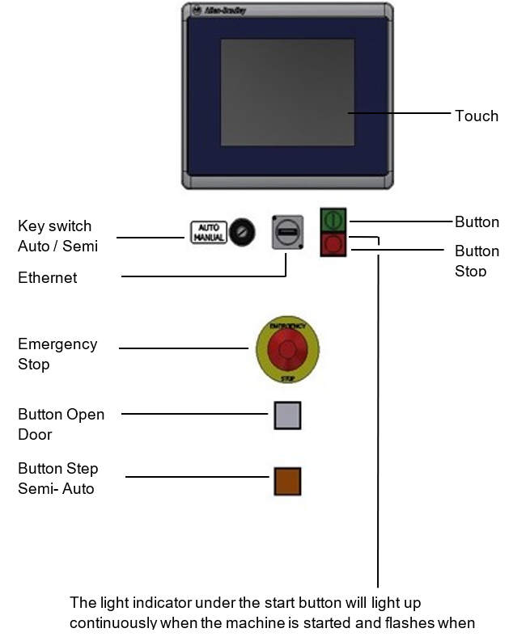

Dit paneel wordt gebruikt om:
1. de start- en stopfunctie te bedienen;
1. de bedrijfsmodus te bepalen;
1. instellingen te bekijken/wijzigen.

De bedieningselementen op het primaire bedieningspaneel omvatten:

1. "Start/Stop" drukknoppen met lichtindicator
    De knoppen starten of stoppen de machine. Knipperende indicator betekent dat de machine opstart, continu licht betekent dat de machine aan staat (loopt).
1. "Semi-Auto / Auto" sleutelschakelaar
    Deze heeft twee modi: Semi-automatische besturing en automatisch. Automatische modus wordt geselecteerd voor productie, semi-automatische modus voor instellingen of inspecties.
1. "Noodstop" drukknop
    Deze knop wordt gebruikt om de cel in veilige modus te brengen in geval van een dreigende noodsituatie.
1. "Stap Handbediening" drukknop met lichtindicator
    Wanneer de machine in handbedieningsmodus wordt gestart en de lichtindicator brandt, kan het programma stap voor stap worden doorlopen.
1. "Deur openen" drukknop met lichtindicator
    Deze knop wordt gebruikt om toegang tot de deuren aan te vragen. De indicator knippert wanneer een verzoek wordt gedaan. De controller brengt de machine in een veilige toestand. Als deze toestand is bereikt, blijft de indicator branden en mogen de deur(en) worden geopend. De toegangsprocedure eindigt wanneer de deuren worden gesloten en de drukknop opnieuw wordt ingedrukt. Als een deur wordt geopend zonder verzoek en toestemming, reageert de machine met een noodstop.
1. Touchscreen
    Dit kan worden gebruikt om de machine te configureren, foutmeldingen te lezen en handbediening te selecteren; voor handbediening moet de sleutelschakelaar op 'Semi-Auto' worden gezet. De beschikbare bedienings- en instellingsschermen worden beschreven in Hoofdstuk 8.
1. Ethernet
    Ethernet-connector voor het uploaden en downloaden van de PLC/touchscreen en het monitoren van de programmatuur.

## Secundair bedieningspaneel

Het secundaire bedieningspaneel biedt beperkte functies. De bedieningselementen worden meestal gebruikt in de opstel- en testfasen. Hieronder worden de locatie en lay-out weergegeven.

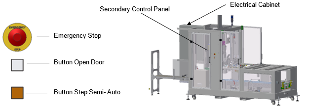

1. "Noodstop" drukknop
    Deze knop wordt gebruikt om de cel in veilige modus te brengen in geval van een dreigende noodsituatie.
1. "Stap Semi Auto" drukknop met lichtindicator
    Wanneer de machine in handbedieningsmodus wordt gestart en de lichtindicator brandt, kan het programma stap voor stap worden doorlopen.
1. "Deur openen" drukknop met lichtindicator
    Deze knop wordt gebruikt om toegang tot de deuren aan te vragen. De indicator knippert wanneer een verzoek wordt gedaan. De controller brengt de machine in een veilige toestand. Als deze toestand is bereikt, blijft de indicator branden en mogen de deur(en) worden geopend. De toegangsprocedure eindigt wanneer de deuren worden gesloten en de drukknop opnieuw wordt ingedrukt. Als een deur wordt geopend zonder verzoek en toestemming, reageert de machine met een noodstop.

## Bedieningselementen op de elektrische kast

Op de elektrische kast zijn extra bedieningselementen aangebracht. Zie boven voor de locatie van de kast, zie hieronder voor de lay-out van de bedieningselementen. Een uitleg van de bedieningselementen is te vinden op de volgende pagina.

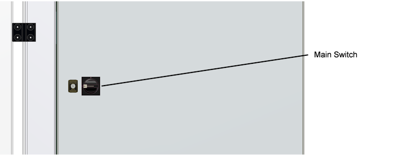

1. Schakelaar "Hoofdschakelaar"
    Dit is de hoofdschakelaar van de machine. Door de schakelaar op 'ON' te zetten, wordt het systeem bekrachtigd. Door de schakelaar op 'OFF' te zetten, wordt het systeem spanningsloos. Om ongeoorloofde toegang te voorkomen, kan de schakelaar in de 'OFF'-positie worden vergrendeld. Dit kan door de grijze pal in te drukken en een hangslot in het gat te bevestigen.

## Signaallichten

Er zijn twee signaallichten op de machine.

1. Blauw licht:
    - Brandt wanneer een probleem wordt gedetecteerd, bijv. het hengselgrijpmagazijn is bijna leeg
    - Knippert om een foutconditie in de machine aan te geven.
1. Rood licht:
    - Knippert om aan te geven dat de deur open is na het starten van de machine in handbediening en dat er nog perslucht aanwezig is.

## Geluidssignaal

De machine is uitgerust met een zoemer die het volgende genereert:
- Intermitterend geluid wanneer een probleem wordt gedetecteerd, bijv. het hengselgrijpmagazijn is bijna leeg.
- Een continu geluid wanneer een foutconditie in de machine optreedt.

De zoemer kan worden uitgeschakeld, zie 'Optie'.

## Noodstopknoppen

Het indrukken van een van de noodstopknoppen resulteert in een noodstop van de machine. Deze modus blijft gehandhaafd tot de knop wordt vrijgegeven (door te draaien keert de knop terug naar de nulpositie). Daarna is de machine klaar om opnieuw te worden gestart.

# Beschrijving van de bedieningsschermen

## Inleiding

Dit hoofdstuk biedt een overzicht van de verschillende schermen van het bedieningspaneel, te beginnen met de algemene schermen.

De bijbehorende procedures worden beschreven in Hoofdstuk 8, met verwijzing naar de relevante bedieningsschermen hieronder.

> Opmerking: Afhankelijk van het model en/of de beschikbare opties op de machine kunnen de schermen afwijken van de getoonde afbeeldingen, of helemaal niet beschikbaar zijn op de machine.

## Algemene termen
- Apparatuurmodule
    Modules in de machine die fysieke modules vertegenwoordigen: (Basisplaat, transportband, centrering, hengselstation, hydrauliek, enz.). Elke apparatuurmodule bestaat uit een of meer besturingsmodules.
- Besturingsmodule
    Besturingsmodules zijn groepen actuatoren en sensoren die een bepaalde functie in de machine uitvoeren. Voorbeelden zijn cilinders, liften en assen (servo's).
- Eindfeedback
    Feedbacksensor aan het einde van een cilinderslag (Let op: wanneer de cilinder in zijn geactiveerde positie staat)
- Startfeedback
    Feedbacksensor aan het begin van een cilinderslag (Let op: wanneer de cilinder in zijn rust/gedeactiveerde positie staat)
- Ontgrendeld
    Er is geen cilinder die de slag van een cilinder die ontgrendeld is blokkeert
- Activeren
    Cilinder begint te bewegen naar de eindpositie
- Deactiveren
    Cilinder begint te bewegen naar de startpositie (rustpositie)
- Activeringstijd
    Tijd die wordt gebruikt wanneer er geen eindfeedback beschikbaar is. Het geeft een vertraging zodat de cilinder voldoende tijd heeft om zijn eindpositie te bereiken voordat de volgende stap wordt gestart.
- Deactiveringstijd
    Tijd die wordt gebruikt wanneer er geen startfeedback beschikbaar is. Het geeft een vertraging zodat de cilinder voldoende tijd heeft om zijn startpositie te bereiken voordat de volgende stap wordt gestart.
- Aan/Uit-vertragingstijd
    Extra tijd om een vertraging te creëren voordat een cilinder wordt geactiveerd/gedeactiveerd

## Hoofdscherm

### Inleiding - Startscherm

Dit scherm wordt weergegeven wanneer de hoofdschakelaar van de machine wordt ingeschakeld.

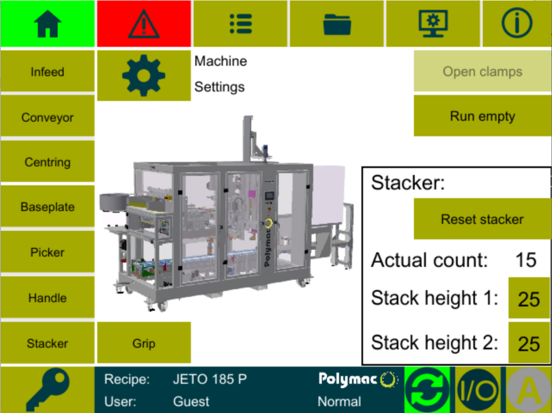

Algemene overwegingen:

In de tweede regel van het scherm bevinden zich de volgende knoppen van links naar rechts:
- De home-knop.
- De alarm-knop.
- De algemene informatie-knop.
- De recept-knop.
- De HMI/PLC-instellingen-knop.
- De informatie-knop.

Onderaan het scherm bevat het lint de volgende knoppen/tekstvelden (van links naar rechts):
- Gebruikersniveau-knop (Sleutel)
- Datum- en tijds tekstveld en informatie over het huidige gebruikersniveau en recept.
- Signaalveld semi-automatisch is aan.
- Signaalveld I/O-test is aan.
- Signaalveld automatisch is aan.

Aan de linkerkant van het scherm bevinden zich de knoppen voor het selecteren van de apparatuurmodules. Bijv. Invoer, Transportband, Basisplaat, enz.

Op het hoofdscherm zelf bevinden zich verschillende knoppen/tellers.
- Machine-instellingen-knop voor aanpassingen van de machine.
- Klemmen openen-knop.
- Leeg laten lopen-knop.
- Stapel resetten-knop.
- Teller die de werkelijke stapelhoogte aangeeft
- Teller voor het instellen van stapelhoogte 1
- Teller voor het instellen van stapelhoogte 2

In de volgende paragrafen worden de functie van deze knoppen, signalen en tellers uitgelegd, te beginnen met het lint bovenaan het scherm.

## Bovenste lint: Home, Alarm, Algemene info, Recept, PLC-instellingen, Info.
### Home-knop

Met deze knop keert men terug naar het hoofdscherm.

### De alarm-knop

Door deze knop in te drukken wordt het alarmscherm geopend.

In dit scherm worden alle actuele alarmen weergegeven.

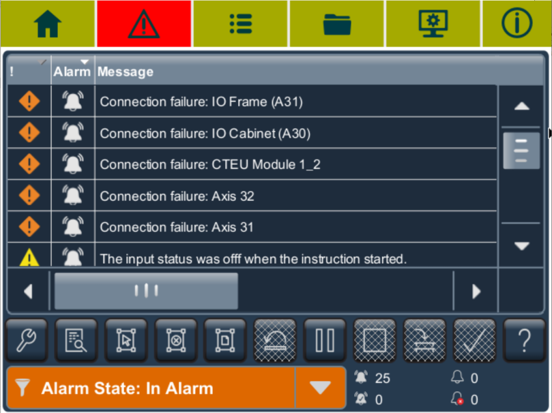

De eerste kolom geeft de ernst van de alarmen aan:

Dringend alarm. Machine is gestopt door een fout van het hoogste niveau (noodstopknop ingedrukt, veiligheid niet OK)

Waarschuwing. Machine heeft een storing met een van de componenten tijdens productie. De machine moet worden gestopt om de storing te verhelpen.

Bericht. Wanneer een bericht wordt weergegeven, is binnenkort een operatoractie nodig om in de loopmodus te blijven.

De tweede kolom geeft aan:

Alarm nog actief

Alarm is niet meer actief (= wordt weergegeven in de alarmgeschiedenis)

De derde kolom "bericht" bevat een beschrijving van het probleem.

Wanneer gedurende een periode meerdere alarmen zijn opgetreden, is het mogelijk de alarmen te filteren met het filter-dropdownvak in de linkerbenedenhoek van deze pagina.

Met de schuifregelaars is het mogelijk door de alarmen te scrollen of meer informatie te verkrijgen over het tijdstip waarop de fout is opgetreden.

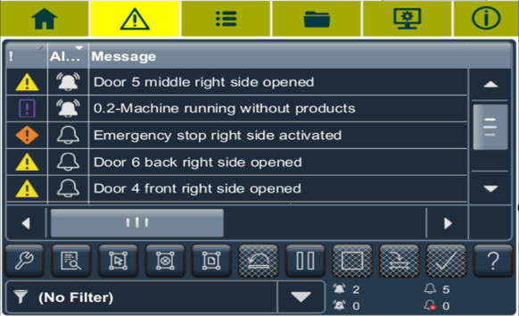

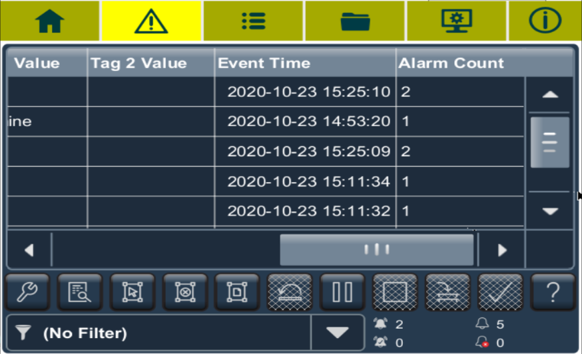

### De algemene informatie-knop

Wanneer u de algemene informatie-knop indrukt, opent een van de volgende vijf schermen.

1. Veiligheidsoverzicht
1. I/O-overzicht
1. PackML-status.
1. Tellersoverzicht
1. Module-cyclustijden.

Het opent altijd met het laatst geopende scherm. De schermen worden in de volgende paragrafen uitgelegd.

#### Veiligheidsoverzicht

Het scherm toont basisinformatie over de status van de noodstop, deuren, hoofd drukventiel en de stuur lucht.

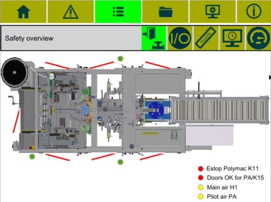
#### I/O-overzicht

Dit scherm opent met een selectievakje om de activering van de uitgangssignalen mogelijk te maken. Dit wordt aangeduid met "Uitgangstest ingeschakeld- !". Met de pijlsymbolen kan men van de ene module naar de volgende navigeren om de bijbehorende in- en uitgangen te bekijken (en te activeren).

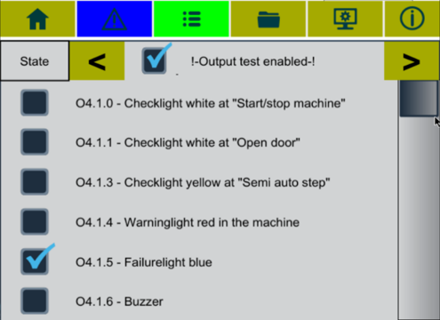

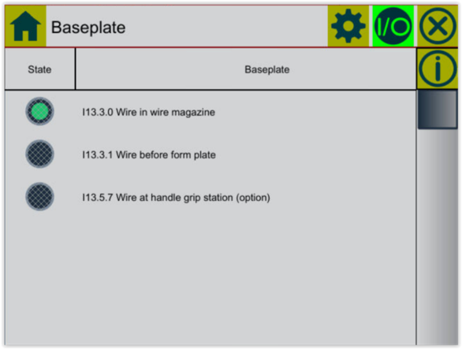

#### PackML-status

De PackML-knop opent een scherm met het PackML-statusoverzicht. Dit overzicht wordt voornamelijk gebruikt voor probleemoplossing.

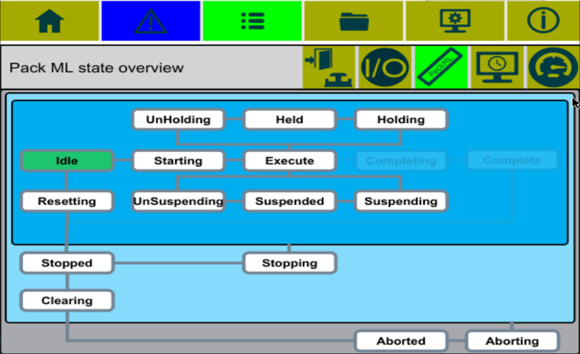

De belangrijkste statussen zijn:

1. Idle (Inactief):
    Machine is in I/O-modus
1. Starting (Starten):
    Machine start (emmers lopen uit, cilinders lopen naar hun startpositie, motoren worden gerefereerd).
1. Execute (Uitvoeren):
    Machine loopt in automatische modus / semi-automatische modus
1. Held (Vastgehouden):
    Machine is in een deur-open-status
1. Stopped (Gestopt):
    Machine is gestopt
1. Aborted (Afgebroken):
    Er is een veiligheidsprobleem opgetreden; de machine wordt in een veilige toestand gebracht tot de veiligheid wordt gereset.

#### Overzicht tellers

Dit scherm geeft een overzicht van de tellers die in de machine aanwezig zijn.

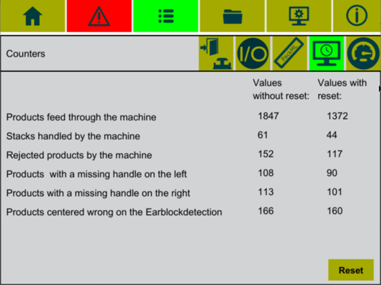

#### Module-cyclustijden

Dit scherm toont de cyclustijden van de afzonderlijke modules evenals van de complete machine. De tijd wordt weergegeven in milliseconden.

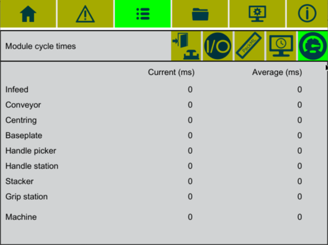

De tijd wordt weergegeven in milliseconden.

### De recept-knop

Wanneer u deze knop indrukt, wordt het receptscherm geopend.

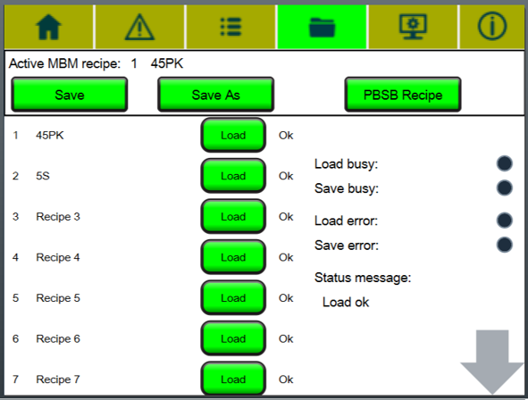

De machine produceert met het actuele recept dat boven aan het scherm wordt weergegeven. Het actuele recept wordt geselecteerd door op de Load-knop achter het gewenste recept te drukken. In elk recept worden de aanpassingen voor één product opgeslagen.

Afhankelijk van het type module waarmee de basismachine is uitgerust, toont dit scherm ook de recepten voor die module. In het bovenstaande voorbeeld is dat de PBSB-module. Door op de knop "PBSB-recept" te drukken, wordt het volgende scherm opgeroepen:

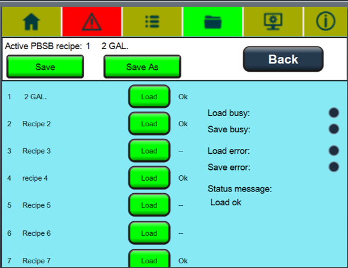

Om een kopie van het actuele recept te maken, gebruikt u de knop Opslaan als.

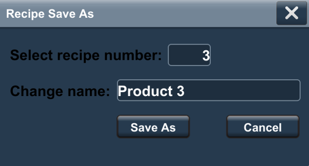

Met dit scherm kunt u het actief zijnde recept naar een ander receptnummer kopiëren. U kunt ook het actieve receptnummer kiezen als u de naam van het actieve recept wilt wijzigen.

Het laden en "Opslaan als" van een recept is alleen mogelijk wanneer de machine is gestopt.

### De configuratie-knop

Wanneer u de configuratie-knop indrukt, worden drie schermen beschikbaar:

1. Taalselectiescherm.
1. Het algemene configuratiescherm
1. Overzicht apparatuurmodulestatus.
1. Het productvolgingsoverzicht

#### Het taalconfiguratiescherm

In dit scherm kunt u de taal op het scherm wijzigen.

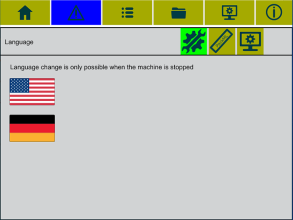

#### Het algemene configuratiescherm

In dit scherm kunt u het netwerk, het display, datum en tijd van het touchscreen configureren. Zie de Rockwell-documentatie voor meer informatie over dit scherm.

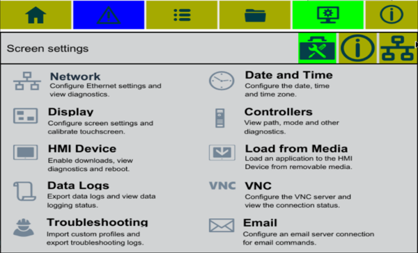

#### Het overzicht apparatuurmodulestatus

Voor elke apparatuurmodule worden de PackML-status en de status van de module weergegeven. Dit overzicht wordt voornamelijk gebruikt voor service-doeleinden.

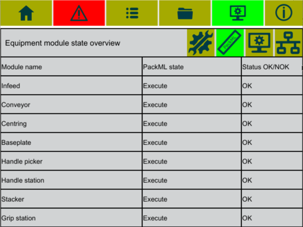

#### Het productvolgingsoverzicht

Dit scherm wordt voornamelijk gebruikt voor debugging- en probleemoplossingsdoeleinden.

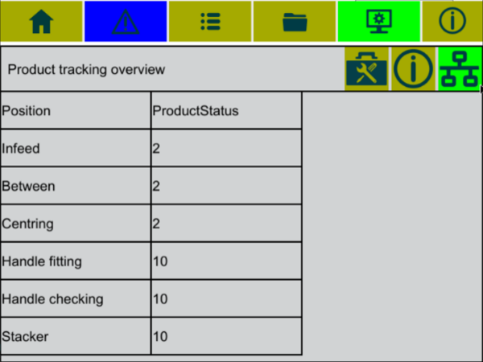

### De informatie-knop

Achter deze knop vindt u algemene informatie over de displaykleuren en knoppen.

In het eerste tabblad vindt u informatie over de gebruikte kleuren en wat de betekenis daarvan is.

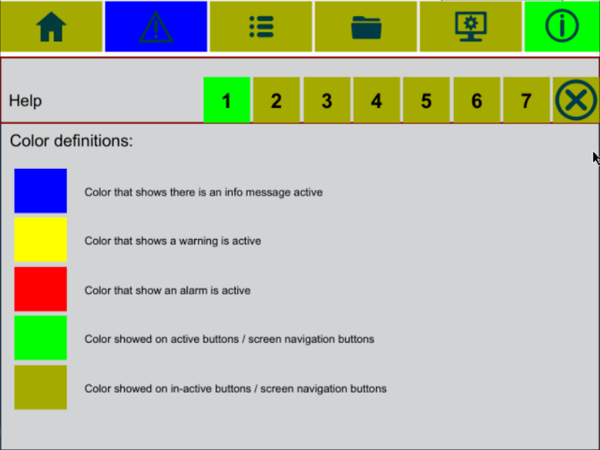

Het tweede tabblad legt de functie van de hoofdschemknoppen uit.

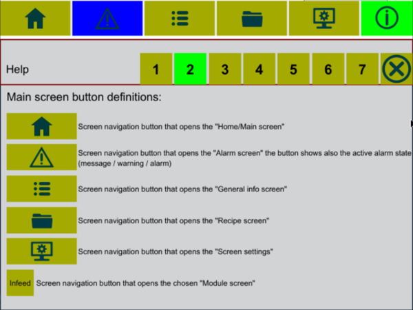

Het derde tabblad legt de functie van de algemene knoppen op het hoofdscherm uit.

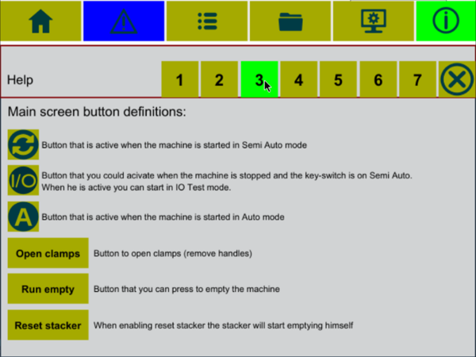

Het vierde tabblad legt de functie van de knoppen van de besturingsmodules in de machine uit.

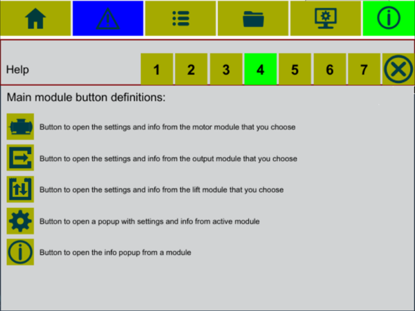

Tabbladen 5 en 6 zijn niet in gebruik.

Tabblad 7 toont de versie van de PLC- en HMI-software.

## Lint aan de linkerkant: Machine-instellingen en apparatuurmodules

#### De machine-instellingen

De hoofdschakelaar op het hoofdscherm opent algemene informatie en instellingen (opties) voor de complete machine. Men kan door de opties scrollen met behulp van de schuifregelaar aan de rechterkant van het scherm.

Sommige instellingen zijn alleen aanpasbaar wanneer de machine is gestopt. Als u dit scherm verlaat door op escape te drukken, worden de oorspronkelijke instellingen opnieuw geladen.

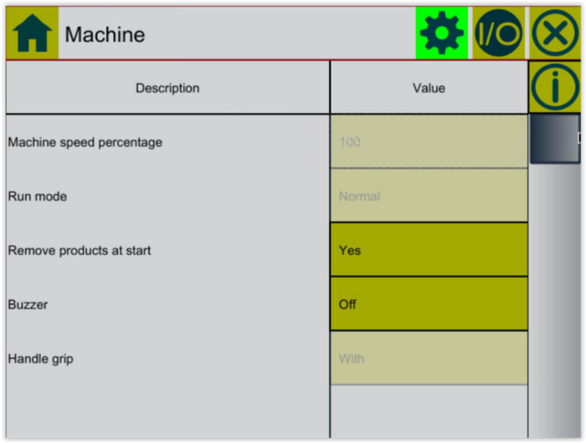

#### Machinesnelheid percentage

Met deze instelling kunt u de snelheid van de machine in % wijzigen.

#### Looptijd (voorheen bedrijfsmodus)

Met deze optie kunt u bepalen in welke modus de machine werkt.

- Normaal:
    Het systeem loopt in normale modus.
- Transport:
    In deze modus passeren de producten de machine (geen hengselmontage of stapeling)
- Stapelen:
    In deze modus passeren de producten de machine en worden ze gestapeld (geen hengselmontage)
- Stapelen met earblock:
    In deze modus passeren de producten de machine, de earblocks zijn operationeel (N1, N2), maar er wordt geen hengsel gemonteerd. Deze modus wordt voornamelijk gebruikt voor service-doeleinden.
- Hengsels:
    In deze modus produceert de machine alleen hengsels.
- Hengsel persen:
    In deze modus kan de machine draaien met producten met kunststof hengsels. Deze hengsels worden met functie J geperst en vervolgens gestapeld.

#### Producten verwijderen bij start
Met deze optie kunt u selecteren wat er met de producten in de machine moet gebeuren wanneer men de machine start of de bedrijfsmodus wijzigt. Wanneer "Producten verwijderen bij start" is uitgeschakeld ("Nee" = geselecteerd), zal de machine niet leeglopen tijdens het starten; dit betekent dat de producten die zich in de machine bevonden zich op exact dezelfde positie moeten bevinden als toen de machine werd gestopt. De machine loopt altijd leeg wanneer de noodstopknop wordt ingedrukt.

#### Zoemer

Zoemer in-/uitschakelen

#### Hengselgreep

Hengsels met of zonder hengselgreep produceren.

#### Hengselsteun N4 *Optioneel*
Functie N4 inschakelen, beweegbaar V-blok voor hengselsteun. Alleen vereist voor specifieke producttypes.

#### Producttype
Hier kan het producttype worden geselecteerd. De mogelijke producttypes zijn: Rond, Ovaal en Rechthoekig.

#### Droogloopmodus
Selectie van deze modus stelt de machine in staat om zonder product in verschillende bedrijfsmodi te draaien (zie Fout: Referentiebron niet gevonden). Het is voornamelijk bedoeld voor test-/service-doeleinden.

### Instellingen van de modules: algemene navigatie
Als u een apparatuurmodule selecteert door op een van de apparatuurmodule-knoppen aan de linkerkant van het hoofdscherm te drukken, wordt een scherm weergegeven met een afbeelding van de gekozen module. Boven aan het scherm ziet u de apparatuurmodule waarmee u werkt.

Het volgende geldt voor alle instellingsschermen:
- Het wijzigen van een instelling resulteert erin dat de machine deze instelling onmiddellijk gebruikt.
- Als u dit scherm verlaat door op escape te drukken, worden de oorspronkelijke instellingen opnieuw geladen.
- Als u dit scherm verlaat door op opslaan te drukken, worden de gewijzigde instellingen opgeslagen en gebruikt.
- Als u het scherm verlaat door op home te drukken, worden de instellingen opgeslagen en opent het hoofdscherm.
- Deze symbolen zijn opdrachten die kunnen worden in-/uitgeschakeld
- Deze symbolen geven statusinformatie van uitgangen/modulestatusinformatie

In de volgende paragrafen worden een aantal van dergelijke apparatuurmodules besproken.

### Invoer
In deze paragraaf gebruiken we de apparatuurmodule "Invoer" als voorbeeld.

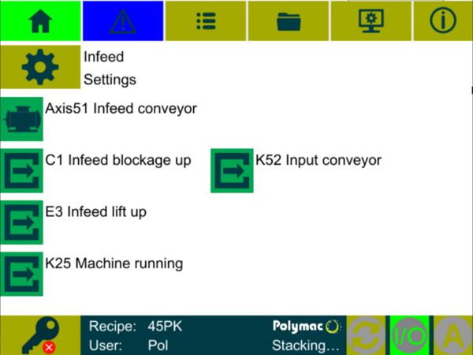

Aan de linkerkant van het scherm worden verschillende besturingsmodule-knoppen weergegeven die bij de gekozen apparatuurmodule horen. Twee besturingsmodules worden besproken: De as invoertransportband en C1 Invoerblokkering omhoog.

#### As invoertransportband

Over het algemeen wordt een besturingsmodule met dit pictogram gebruikt voor servo- of frequentiegeregelde motoren. Wanneer u op deze knop drukt, wordt het volgende instellingsscherm weergegeven.

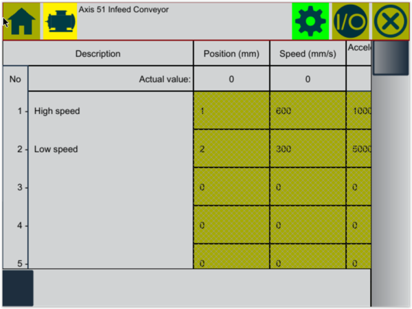

In dit voorbeeld is er één motor met twee snelheden. Voor elke snelheid kunnen de verplaatsingsafstand, snelheid, versnelling en vertraging worden ingesteld.

Voor het statusoverzicht en de I/O-besturing van de module drukt u op de I/O-knop boven aan het scherm.

Het volgende scherm wordt weergegeven.

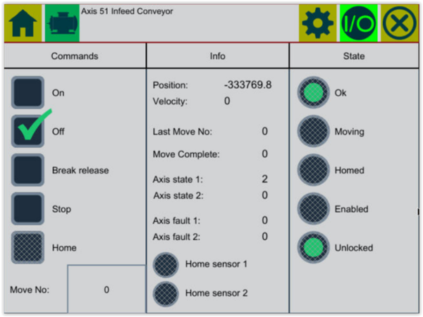

Dit scherm is verdeeld in drie delen:

1. opdrachtgedeelte
1. informatiedeel
1. statusdeel

Als de machine in I/O-testmodus staat en de module niet in storing is, is het mogelijk opdrachten aan de as te geven. Om een beweging van de as in I/O-testmodus te starten, moeten de volgende opdrachten worden gegeven:

1. Druk op "ON" (= motor wordt bekrachtigd)
2. Druk op "Home" als deze opdracht ontgrendeld is (= motor wordt gerefereerd naar zijn nulpositie)
3. Vul het bewegingnummer in van de "Move" die u wilt zien (Move Nr: ??)
4. Nu begint de motor te bewegen
5. Maak het Move Nr weer nul (nu kunt u de volgende move starten)

#### Instellingen in-/uitgangen. Bijv. C1 Invoerblokkering omhoog

Over het algemeen wordt dit type besturingsmodule gebruikt voor kleppen en directe (aan/uit) motoren.

Wanneer u op deze knop drukt, wordt het volgende configuratiescherm weergegeven. Het is verdeeld in drie delen:

1. Een opdrachtgedeelte aan de linkerkant
1. Een in-/uitgangsgedeelte in het midden
1. Een statusgedeelte (volgens PackML) aan de rechterkant.

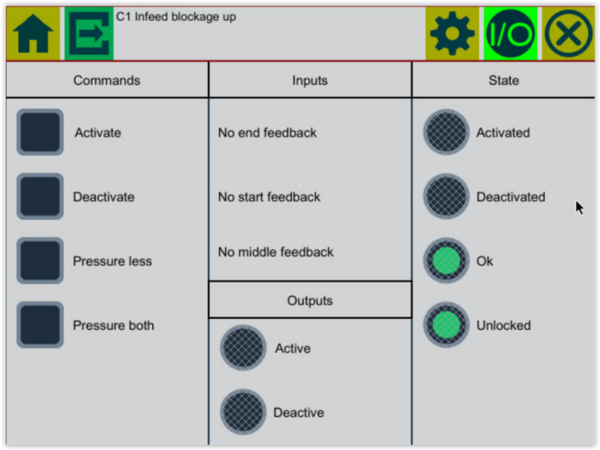

Als de machine in testmodus staat en de module niet in storing is, is het mogelijk opdrachten aan de klep te geven. Druk op de knoppen activeren, deactiveren of drukkeloos om de klep te testen.

In dit voorbeeld wordt een klep zonder feedbacksensoren gebruikt. Dit wordt aangeduid door de afwezigheid van ingangen. Voor dit type sensoren is het mogelijk een vertragingstijd in te stellen bij activering/deactivering van de klep door op de instellingenknop te drukken.

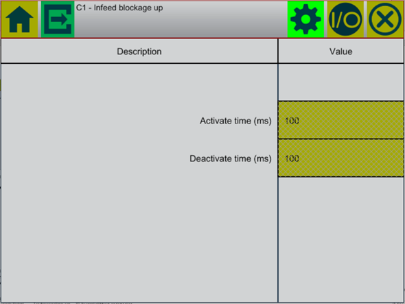

In het geval van een klep met feedbacksensoren is het mogelijk een time-out op de klep in te stellen.

### Apparatuurmodules: inleiding

Met de algemene navigatie uitgelegd voor de besturingsmodules, geven de volgende paragrafen een beschrijving van de individuele apparatuurmodules, hun functies en de besturingsmodules die in deze apparatuurmodules aanwezig zijn.

### Transportband

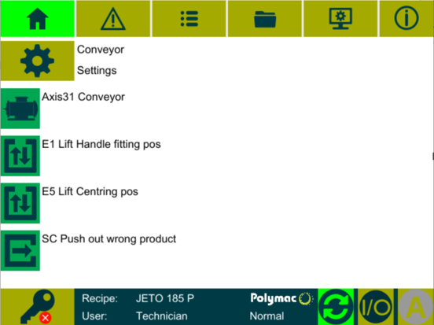

Het tabblad transportband bevat vier besturingsmodules: As31 transportband, E1 Lift hengselmontagepositie, E5 Lift centreerpositie en SC Uitduwen verkeerd product. Aangezien de besturingsmodule van de transportband vergelijkbaar is met die van de invoer, worden in deze paragraaf alleen de lift en de duwer besproken.

#### E1 Lift hengselmontagepositie

Wanneer u op deze knop drukt, wordt het volgende configuratiescherm weergegeven. Het is weer verdeeld in drie delen:

1. Een opdrachtgedeelte aan de linkerkant
1. Een in-/uitgangsgedeelte in het midden
1. Een statusgedeelte aan de rechterkant.

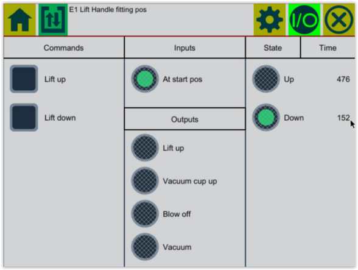

Door op de instellingenknop te drukken, kan men verschillende timers instellen die met deze lift verband houden.

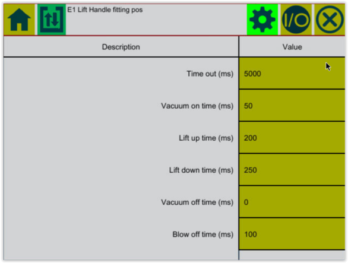

1. Time-out
    Geeft de tijd in milliseconden aan die is toegestaan tussen activering van de lift en het ingangssignaal dat de lift zijn bestemming heeft bereikt.
1. Vacuüm aan-tijd
    Geeft een wachttijd aan tussen het inschakelen van het vacuüm en het starten van op- en neergaande beweging.
1. Lift omhoog-tijd
    Geeft de tijd aan dat de lift in zijn bovenste positie moet zijn.
1. Lift omlaag-tijd
    Geeft de tijd aan die nodig is om met de lift omlaag te gaan voordat het vacuüm wordt uitgeschakeld en met afblazen wordt begonnen. Wanneer deze tijd langer is ingesteld dan de tijd die de lift nodig heeft om de sensor in de omlaag-positie te bereiken, wordt deze timer uitgeschakeld en wordt het vacuüm uitgeschakeld en wordt het afblazen geactiveerd bij het bereiken van deze sensor.
1. Afblaastijd
    Geeft de tijdsduur aan waarin het vacuüm wordt afgeblazen.

#### SC Uitduwen verkeerd product

Wanneer u op deze knop drukt, wordt het configuratiescherm van de SC-functie weergegeven. Het is weer verdeeld in drie delen:

1. Een opdrachtgedeelte aan de linkerkant
1. Een in-/uitgangsgedeelte in het midden
1. Een statusgedeelte aan de rechterkant.

De bijbehorende instellingen zijn te vinden door op de instellingenknop te drukken. Deze cilinder heeft extra instellingen omdat een Aan-vertraging en Uit-vertraging helpen bij het fijn afstemmen van deze "verwijderingsprocedure".

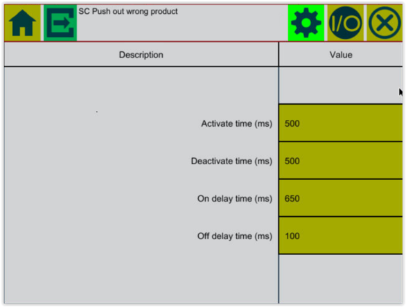

1. Activeringstijd
    Geeft de tijd aan die de cilinder nodig heeft om zijn geactiveerde toestand (= eindpositie) te bereiken.
1. Deactiveringstijd
    Geeft de tijd aan die de cilinder nodig heeft om zijn gedeactiveerde toestand (= startpositie) te bereiken.
1. Aan-vertragingstijd
    Geeft de vertraging aan bij activering van de duwer wanneer het product de positie "uitgangszone" vol bereikt.
1. Uit-vertragingstijd
    Geeft de vertraging aan bij het terugtrekken van de duwer.

### Centrering

Het tabblad centrering bevat één besturingsmodule: As32 Centrering. De knoppen Centrering opnieuw en Camera aanleren zijn ingeschakeld wanneer de machine in Semi Auto-modus loopt.

1. Centrering opnieuw:
    Deze knop kan worden ingedrukt wanneer de machine een product in Semi Auto-modus heeft gecentreerd. Door op deze knop te drukken, wordt de emmer opnieuw gecentreerd. Deze knop wordt voornamelijk gebruikt voor service-/debugdoeleinden.
1. Camera aanleren *Optioneel*:
    Deze knop is beschikbaar wanneer de machine in Semi Auto-modus loopt met de optie CWL-detectie "AAN". Wanneer er een emmer onder de centreereenheid is geklemd, kan het Child Warning Label op de emmer worden aangeleerd volgens de stappen die op het HMI-scherm verschijnen.
1. Centreringsinstellingen:
    Deze instellingen zijn belangrijk om de producten op de juiste manier te centreren. De volgende drie instellingen kunnen hier worden ingesteld: Centreringsmethode, invoeroriëntatie tamper evident en stapeloriëntatie tamper evident.
    
1. Centreringsmethode:
    Er zijn twee opties om de producten te centreren. De twee opties zijn "Direct" en "Earblock". Directe centrering is alleen mogelijk wanneer de machine met rechthoekige of ovale producten loopt. Wanneer deze instelling is geselecteerd, worden de producten gedraaid naar een positie die direct is ingesteld zonder een detectiepunt op de emmer te zoeken. Wanneer de instelling "Earblock" is geselecteerd, wordt het centreren van het product gedaan door het zoeken naar het Earblock. Wanneer het is gevonden, draait de centreerschijf naar de eindpositie met een offset die door de gebruiker/operator is ingesteld (zie paragraaf: 8.5.6.1).
    
1. Invoeroriëntatie tamper evident:
    Deze instelling heeft twee opties. De twee opties zijn "Links" en "Rechts". Deze instelling is alleen zichtbaar wanneer de machine met rechthoekige of ovale producten loopt. Deze instelling wordt gebruikt om ervoor te zorgen dat de tamper evident na het centreren in de juiste positie eindigt. De gebruiker/operator moet instellen of de tamper evident links of rechts is wanneer de emmer de machine binnenloopt.
    
1. Stapeloriëntatie tamper evident:
    Deze instelling heeft twee opties. De twee opties zijn "Voor" en "Achter". Deze optie moet door de gebruiker/operator worden geselecteerd om ervoor te zorgen dat het product na het centreren met de tamper evident in de juiste richting eindigt. Dit kan aan de voor- of achterzijde zijn, afhankelijk van de klantwensen.
1. Centreringscamera-controle *Optioneel*:
    Deze instelling heeft twee opties. De twee opties zijn "aan" of "Uit". Deze optie moet
        1. Aan zijn wanneer een product moet worden gecentreerd met een logo op het product dat na het centreren altijd op dezelfde positie moet eindigen. Wanneer de optie Aan is, controleert de camera een aangeleerd punt op het product tijdens het centreren, en wanneer het aangeleerde punt wordt gevonden, draait het product naar de juiste eindpositie.

#### As 32 Centrering
Wanneer u op deze knop drukt, wordt het configuratiescherm van de centreerfunctie weergegeven. Het is weer verdeeld in drie delen:

1. Een opdrachtgedeelte aan de linkerkant
1. Een in-/uitgangsgedeelte in het midden
1. Een statusgedeelte aan de rechterkant.

Door de instellingenknop te activeren, komt men in het volgende scherm.

1. 'Nulpositie'
    wordt alleen gebruikt voor het centreren van ovale en rechthoekige producten. Dit is de positie waarbij de centreerschijf in lijn is met de transportband. Naast de positie kunnen de snelheid, versnelling en vertraging voor deze beweging worden ingesteld.
    
1. 'Zoekpositie'
    is een vaste positie, maar de snelheid, versnelling en vertraging kunnen worden ingesteld. Deze worden gebruikt tijdens het zoeken naar het aangeleerde punt op de emmer (Earblock, tamper evident of hengselgat).
1. 'Zoek eindpositie (berekend)'
    is een vaste berekende eindpositiewaarde. Dit is de positie waar de centreerschijven naartoe draaien na het vinden van het aangeleerde punt. De snelheid, versnelling en vertraging die tijdens deze beweging worden gebruikt, kunnen worden ingesteld.
1. 'Zoek eindpositie offset (ingesteld)'
    is een offsetwaarde die wordt gebruikt om de eindpositie van move 3 te berekenen na het vinden van de aangeleerde positie. Hier wordt alleen de afstandsinstelling gebruikt.
1. 'Directe eindpositie (berekend)'
    is een vaste berekende eindpositiewaarde. Dit is de positie waar de centreerschijf naartoe beweegt wanneer "Directe centrering" is geselecteerd en de machine ovale/rechthoekige producten verwerkt. De snelheid, versnelling en vertraging die tijdens deze beweging worden gebruikt, kunnen worden ingesteld.
1. 'Directe eindpositie (ingesteld)'
    is een offsetwaarde die wordt gebruikt om de eindpositie van move 5 te berekenen na het vinden van de aangeleerde positie. Hier wordt alleen de afstandsinstelling gebruikt.

### Instellingen op hoofdscherm
#### Leeg laten lopen

Door op deze knop te drukken worden alle producten (emmers, hengsels) uit de machine verwijderd. Wanneer de machine leeg is, verschijnt een bericht om de machine te stoppen of "Leeg laten lopen" uit te schakelen.

#### Klemmen openen

Dit opent alle klemmen die een hengsel klemmen om deze hengsels te verwijderen. Na het indrukken van "Klemmen openen" altijd de hengsels verwijderen die uit de klemmen vallen, anders veroorzaakt dit schade aan de machine.

#### Stapelaar

Het stapelaarvenster op het hoofdscherm bevat

1. Een knop om de stapelaartellingen te resetten. Het resetten van de stapelaartellingen zorgt ervoor dat de stapelaar leegloopt.
1. Een teller die de werkelijke stapelhoogte aangeeft
1. Een teller voor het instellen van stapelhoogte 1
1. Een teller voor het instellen van stapelhoogte 2

# Beschrijving van de bedieningsprocedures

## Opstarten

1. Controleer of alle veiligheidsvoorzieningen en geleiders in goede orde en aanwezig zijn.
1. Zorg ervoor dat er geen losse oude producten in de machine aanwezig zijn.
1. Controleer of alle noodstopknoppen zijn vrijgegeven.

1. Sluit de deuren.
2. Zet de hoofdschakelaar op ON.

## Bedrijfsmodi

### Selectie

Selecteer de bedrijfsmodus met de sleutelschakelaar op het primaire bedieningspaneel om te schakelen tussen 'Semi / Auto' en de automatische modus.

1. Auto
    Automatische modus, om productie te draaien.
1. Semi
    voor semi-automatisch geselecteerd, semi-automatische modus, om automatisch stap voor stap te draaien

Alleen als de machine in semi-automatische modus loopt, is het mogelijk de I/O-testmodus op het display te selecteren.

Een van de drie signalen in de rechteronderhoek van het hoofdscherm licht op om de modus aan te geven waarin de machine loopt.

### Automatische modus

1. De machine is gestopt.
1. Zet de keuzeschakelaar in de positie 'Auto'.
1. Druk op de startknop op het 'Bedieningspaneel'.
1. Wanneer de startprocedure is voltooid, is de machine klaar om in automatische modus te werken. De PackML-status is nu 'uitvoeren' en de machine draait productie.

### Semi-automatische modus

1. De machine is gestopt.
1. Zet de keuzeschakelaar in de positie 'Semi'.
1. Selecteer Semi-automatisch met de knop op het hoofdscherm.
1. Druk op de startknop op het 'Bedieningspaneel'.
1. Wanneer de startprocedure is voltooid, is de machine klaar om semi-automatisch te werken. De machine loopt een stap verder wanneer u op de drukknop 'Semi-Auto besturing' drukt.
1. Voer de gewenste controles of instellingswijzigingen uit.

### I/O-testmodus

1. De machine is gestopt.
1. Zet de keuzeschakelaar in de positie 'Semi'.
1. Selecteer I/O-test met de knop op het hoofdscherm.
1. Druk op de startknop op het 'Bedieningspaneel'.
1. Wanneer de startprocedure is voltooid, is de machine klaar om in I/O-/testmodus te werken. In het Info-scherm van elke apparatuurmodule kunt u kleppen en motoren handmatig bedienen.

### Schakelen tussen semi-automatische en automatische modus
- Om van automatische modus naar semi-automatische modus te schakelen, zet u de sleutelschakelaar op 'Auto'.
- Om van semi-automatische modus naar automatische modus te schakelen, zet u de sleutelschakelaar op 'Semi'.
- Dit is mogelijk tijdens productie, zonder de machine te stoppen.

### Schakelen tussen semi-automatische / automatische modus en I/O-testmodus

- Om van automatische modus naar I/O-testmodus te schakelen, stopt u de machine. Zet de sleutelschakelaar op 'Semi'. Selecteer I/O met de knop op het hoofdscherm. Druk op de startknop op het 'Bedieningspaneel'.
- Om van semi-automatische modus naar I/O-testmodus te schakelen, stopt u de machine. Selecteer I/O-test met de knop op het hoofdscherm. Druk op de startknop op het 'Bedieningspaneel'.

## Stoppen

Druk op de stopknop op het 'Primaire bedieningspaneel'. De machinedelen keren terug naar de rustpositie en stoppen.

## Noodstop

Gebruik de noodstopfunctie alleen om dreigende gevaarlijke situaties of machineschade af te wenden. De noodstopknoppen zijn beschreven in het overzicht.

Het indrukken van een van de noodstopknoppen resulteert in een noodstop van de machine, waardoor de aandrijvingen stoppen en de pneumatische en hydraulische circuits drukloos worden.

Na het indrukken van een van de knoppen gaat u als volgt te werk:

1. Breng betrokken personeel in veiligheid / verleen medische zorg als er veiligheidskwesties zijn.
1. Repareer de schade als er materiële aspecten zijn.
1. Draai de ingedrukte knop los tot de knop terugkeert naar de nulpositie.
1. Daarna is de machine klaar om opnieuw te worden gestart.

## Omstelling
Zie voor conversie en omstelling hoofdstuk 11 'Conversie'.

# Onderhoud

## Algemene onderhoudspunten

### Veilig onderhoud

Alleen een goed onderhouden machine kan veilig en nauwkeurig blijven werken. Het is ook belangrijk de machine regelmatig schoon te maken.

Voer onderhoud uit volgens de onderstaande instructies, zie ook het onderhoudsschema in TBD.

> Waarschuwing: Onderhoud mag alleen worden uitgevoerd door technisch geschoold personeel dat bekend is met de werking en risico's van de machine. Dit geldt voor alle onderhouds- en reparatiewerkzaamheden.

> Waarschuwing: Schakel de machine altijd uit vóór onderhoud.
1. Plaats een hangslot (Ø4-8) in de hoofdschakelaar, houd de sleutel bij u en plaats een waarschuwingsbord: "Uitgeschakeld voor onderhoud", inclusief naam, start- en (verwachte) einddatum.
1. Verzeker de veiligheid van de machine zoals beschreven in §6.5
1. Schakel veiligheidsvoorzieningen nooit uit
1. Verwijder geen vaste afschermingen (panelen en ruiten).

### Algemene overwegingen

1. Reinig de machine regelmatig, verwijder vuil en afval. Houd de omgeving ook schoon.
1. Controleer periodiek op schade, losse bevestigingen of andere visuele en auditieve afwijkingen.
1. Controleer periodiek de luchtcilinders en slangen op lekken.
1. Houd vacuümkanalen en -slangen schoon.

## Smering

### Lineaire systemen

Goede smering is essentieel voor de efficiënte prestatie van het lineaire systeem. Onjuiste smering leidt niet alleen tot een verhoogd slijtagerisico, maar ook tot een aanzienlijke verkorting van de levensduur.

Smering:

1. Vermindert slijtage en wrijvingsweerstand, zoals inwendige erosie van de bewegende delen.
1. Creëert een gelijkmatige laag vet op de transportbanden, vermindert de belastingsdruk en verlengt de levensduur.
1. Beschermt metaaloppervlakken tegen corrosie.

Om de prestaties van het lineaire systeem niet te beïnvloeden en de smering gedurende een langere periode te behouden, moet het gebruikte smeermiddel compatibel zijn met de omgevingsomstandigheden en aan alle specifieke eisen voldoen.

Over het algemeen moet een smeerinterval van \(5000 km\) bedrijfscapaciteit of minimaal eenmaal per 6 maanden worden aangehouden. Deze capaciteit kan onder speciale omgevingsomstandigheden lager zijn. Relevante factoren kunnen zijn:

1. Extreme bedrijfstemperaturen;
1. Invloed van condensatie en spatwater;
1. Hoge trillingsbelasting;
1. Afzetting van bepaalde stoffen (zuren, koolwaterstoffen);
1. Hoog dynamisch gebruik;
1. Permanent kleine slagbewegingen.

De smering van het lineaire systeem wordt uitgevoerd met de smeernippel op de lineaire wagen en een geschikt vetpistool. Gebruik een vetpistool met een bekend afgiftevolume (bijvoorbeeld THK MG70) en het juiste vettype. Let op: te veel vet resulteert in te veel druk in het lagerblok, wat voortijdige uitval veroorzaakt. Raadpleeg de smeertabel voor de aanbevolen hoeveelheid en het onderhoudsschema voor de intervallen.

> Info: Vettype: Lithiumgebaseerd EP2-vet (bijvoorbeeld THK AFB-LF vet).
    Te veel vet kan voortijdige uitval veroorzaken

Nasmertabel
Lagergrootte versus nasmeerhoeveelheid (cm³)
- 15: 0,6
- 20: 1,2
- 25: 2,0
- 30: 3,0
- 35 (lengte ca. 122 mm): 3,4
- 35L (lengte ca. 152 mm): 5,2

### Smering van reductiekasten

De reductiekasten zijn voorzien van synthetische olie. De olie in de reductiekast moet worden vervangen na 10.000-12.000 bedrijfsuren of minimaal na 2 jaar. Let op dat ook PG 220 synthetische olie wordt gebruikt. Voor een Zae wormwielkast moet 0,2 L olie worden voorzien.

De volgende olietypen worden aanbevolen:

1. Aral: Degol GS 220
1. BP: BP Energol SG-XP220
1. Esso: Umlaufol S220
1. Mobil: Mobil Glygoyl 30
1. Shell: Tivela Oil WB
1. Tribol: Tribol 800/220

### Smering van trommelmotoren (indien aanwezig)

De trommelmotoren zijn voorzien van olie. De eerste olieverversing wordt aanbevolen na 200-300 bedrijfsuren, elke volgende verversing na 10.000 bedrijfsuren. De oliespecificatie is 100cST/40°C of 8°Engler/50°C. De olie is geschikt voor omgevingstemperaturen van \(-20^{\circ}C\) tot \(+50^{\circ}C\). Als een ander olietype wordt gebruikt, zorg er dan voor dat het geen additieven bevat die de motorisolatie kunnen beschadigen. In geen geval mogen oliën met grafiet, molybdeendisulfide of een ander elektrisch geleidend additief worden gebruikt, omdat deze de trommelmotor beschadigen.

De volgende olietypen worden aanbevolen:

1. Fina: Giran N100
1. Gastrol: Alpha ZN 100
1. BP Energol GR-XP 100
1. Esso: Nuto H 100
1. Mobil: Mobil-Gear 627
1. Shell: Omala 100
1. Texaco: Meropa 100
1. DEA: Falcon CLP 100

Om de olie te verversen, verwijdert u de vulbout op de flens aan de aansluitzijde van de trommelmotor. Zorg er bij het installeren van de trommelmotor altijd voor dat de vulbout of rode stip zich boven bevindt, anders kan koeling niet worden gegarandeerd. Voor een trommelmotor type 110 met 300 mm lengte is 0,6 liter olie nodig, een 350 mm lange motor biedt 0,7 liter olie en een 400 mm lange motor 0,8 liter. Zorg ervoor dat de olie op een milieuvriendelijke manier wordt afgevoerd.

## Tandriemen (indien van toepassing)

De machine is uitgerust met tandriemen voor het uitvoeren van diverse bewegingen. De tandriemaandrijvingen moeten regelmatig worden gecontroleerd.

### Checklist voor onderhoud van tandriemen

1. Schakel de aandrijving uit.
1. Plaats alle machinedelen in een veilige (neutrale) positie.
1. Controleer de riem op slijtage of schade. Vervang indien nodig. Zie Installatie van tandriemen.
1. Controleer de schijven en tandwielen en vervang ze bij slijtage of beschadiging.
1. Controleer ook andere aandrijfcomponenten zoals lagers, assen, bevestigingspunten, enz.
1. Controleer de riemspanning en stel indien nodig bij.
1. Controleer de uitlijning van de schijven opnieuw.
1. Sluit de machine aan en laat de aandrijving draaien. Let op afwijkingen (visueel en auditief).

### Installatie van tandriemen
1. Na het uitschakelen van de machine en het vergrendelen van de hoofdschakelaar, ontkoppelt u de bevestigingspunten in de motor of de spanner. Verwijder de riem zonder deze te buigen of te draaien. Draai een riem niet van de schijf af!
1. Verwijder en inspecteer de oude riemen. Abnormale of overmatige slijtage kan wijzen op onjuist onderhoud.
1. Kies de juiste vervangende riem. (Zie de mechanische onderdelenlijst).
1. Reinig de schijven en spanners met een doek die licht is bevochtigd met een mild, niet-vluchtig oplosmiddel. Gebruik geen scherp voorwerp om vet of vuil van de riem te verwijderen. Riemen moeten droog op de aandrijving worden gemonteerd.
1. Controleer de tandwielen op buitengewone of overmatige slijtage. Controleer ook de uitlijning. Correcte uitlijning is vooral kritisch bij synchrone riemen.
1. Controleer de andere aandrijfcomponenten. Zijn lagers en assen correct uitgelijnd en goed gesmeerd? Zijn ze versleten?
1. Monteer de nieuwe riem op de tandwielen. Draai of forceer niet.
1. Stel de riem af tot de spanningsmeter de juiste spanning aangeeft. Draai de aandrijvingen een paar omwentelingen met de hand en controleer de spanning opnieuw.
1. Draai de bouten van de bevestigingspunten in de motor of de spanner goed vast. Alle aandrijfcomponenten moeten stevig op hun plaats zitten, omdat elke verandering van de hartafstand de prestaties van de aandrijving aantast.
1. Hoewel de riemen geen naspanning vereisen, raden we aan de aandrijving te laten draaien en deze zorgvuldig te observeren. Let op ongewone geluiden en trillingen. Schakel de machine uit en controleer de lagers en motor. Als ze heet aanvoelen, is de riem mogelijk te strak, of zijn de lagers verkeerd uitgelijnd of onjuist gesmeerd.

## Specificaties hijsogen

De module is uitgerust met vier hijsogen van het type: RUD VRS-F M16/1,5T. Deze hijsogen zijn 360° verstelbaar in de benodigde krachtrichting. Deze bouten voldoen aan DIN EN 1677-1 : 2009-03.

Eén bout heeft een WLL van 1,5 ton. De bouten moeten met 60 Nm worden vastgedraaid.

Verwijder deze bouten niet van de module.

## Klem- en stootcomponenten

### Installatie-instructies voor klem- en stootcomponenten

1. Reinig montageoppervlakken van klem- en stootcomponenten
1. Smeer montageoppervlakken en bouten
1. Monteer klem- en stootcomponenten
1. Draai bouten **licht** aan
1. Start machine in handbediening
1. Doorloop 1 run in handbediening
1. Stop de machine
1. Draai bouten aan met het juiste aanhaalmoment: 18 Nm
1. Stop de machine
10. Klem- en stootcomponenten klaar voor gebruik

> Info: Gebruik DIN 7984 M8x25 10.9 bouten

### Onderhoudsinstructies voor klem- en stootcomponenten

Klem- en stootcomponenten zijn het meest effectief wanneer er geen vuil en stangenspanen op de klem- en stootoppervlakken aanwezig zijn. Deze oppervlakken moeten regelmatig worden gecontroleerd en indien nodig worden gereinigd.

1. Maandelijks
    1. Inspecteer klem- en stootcomponenten op vervuiling
    1. Reinig indien nodig de klem- en stootoppervlakken met een droge doek

## Drukschakelaars instellen

Drukschakelaars afstellen:
1. Activeer de noodstopknop.
1. Verlaag de luchtdruk bij het spruitstuk tot onder 2 bar.
1. Activeer het luchttoevoerspruitstuk handmatig.
1. Stel de luchtdruk bij het spruitstuk in op de waarde voor de gewenste drukschakelaar (voor waarde zie pneumatische tekening pagina 901).
1. Voor drukschakelaars die achter een klep zijn geplaatst, schakelt u eerst de klep handmatig in.
1. Druk de knop Druksensor bewerken 3 sec in.
1. Herhaal stap 4 tot 6 voor de andere drukschakelaars.
1. Schakel handmatig geactiveerde kleppen uit.
1. Schakel het handmatig geactiveerde luchtspruitstuk uit.

Drukschakelaars controleren:

1. Verlaag de luchtdruk bij het spruitstuk tot onder 2 bar.
1. Activeer het luchttoevoerspruitstuk handmatig.
1. Verhoog de luchtdruk bij het spruitstuk.
1. Voor drukschakelaars die achter een klep zijn geplaatst, moeten kleppen handmatig worden ingeschakeld.
1. De druksensor moet zijn ingeschakeld wanneer de luchttoevoerregelaar de vooraf ingestelde waarde bereikt (voor waarde zie pneumatische tekening pagina 901).
1. Verhoog de luchttoevoer naar 7 bar.
1. Schakel handmatig geactiveerde kleppen uit.
1. Schakel het handmatig geactiveerde luchtspruitstuk uit.

Drukschakelaars zijn nu ingesteld.
1. Deactiveer de noodstopknop.
1. De machine kan nu worden gestart.

## Vervangen of instellen van drukschakelaars voor machine met veiligheidsklep H1 (optioneel)
Als de machine is uitgerust met een veiligheidsklep H1 (type D2, Level D, Cat 3), kan de bovenstaande procedure niet worden gevolgd.

Er zijn twee opties wanneer de schakelaars moeten worden vervangen:

1. Bestel vooraf geconfigureerde schakelaars bij Polymac. Geef aan of de schakelaar moet worden geconfigureerd voor 3 bar (PA: PNH-B3 en H: PNH-B1) of 5 bar (P: PNH-B4).
1. Configureer de schakelaar buiten de machine. De procedure hiervoor wordt in deze paragraaf beschreven.

### Drukschakelaars buiten de machine configureren
1. Benodigde apparatuur:
    1. Festo drukschakelaar
        
    1. Drukregelaar met manometer en handmatige afsluitklep
        
    1. 24V voeding
        
    1. Driepolige sensorkabel.
        
    1. Plug/Stop
        
1. Sluit de sensorkabel aan op de drukschakelaar. Sluit de bruine draad van de sensorkabel aan op 24V en de blauwe op 0V van de voeding.

1. Steek de bovenkant van de druksensor erop. Sluit de onderkant aan op de drukregelaar. Zorg ervoor dat de handmatige afsluitklep in de gesloten positie staat. Zorg er ook voor dat de knop in de gesloten positie staat door deze tegen de klok in te draaien tot deze blokkeert.

1. Sluit een pneumatische bron aan op de drukregelaar. De druk moet minimaal 6 bar zijn.

1. Open de handmatige afsluitklep.

1. Draai de knop met de klok mee tot de manometer 3 bar aangeeft.
1. Druk op de "Edit"-knop op de schakelaar.

1. De schakelaar licht op wanneer deze is ingesteld.
1. Om de schakelaar voor 5 bar te configureren, opent u de regelbare klep verder tot de manometer 5 bar aangeeft.
1. Druk op de "Edit"-knop op de schakelaar.

## Specificaties hijsogen
De module is uitgerust met vier hijsogen van het type: RUD VRS-F M16/1,5T. Deze hijsogen zijn 360° verstelbaar in de benodigde krachtrichting. Deze bouten voldoen aan DIN EN 1677-1 : 2009-03.

Eén bout heeft een WLL van 1,5 ton. De bouten moeten met 60 Nm worden vastgedraaid.

Verwijder deze bouten niet van de module.

## Onderhoudsschema

# Conversie

## Inleiding

Gebruik de onderstaande aanpassingslijst om de machine om te bouwen naar een ander product. Alle benodigde uitwisselonderdelen bevinden zich op of onder de oppervlaktebanden.

> Waarschuwing: Conversie mag alleen worden uitgevoerd door technisch geschoold personeel dat bekend is met de werking en risico's van de machine. Dit geldt voor alle onderhouds- en reparatiewerkzaamheden.

## Voorbereiding

Controleer voordat u met de conversie begint of de machine is uitgeschakeld en vergrendeld en of de benodigde gereedschappen en onderdelen binnen handbereik zijn.

Volg de onderstaande stappen zodat u geen belangrijke aanpassingen of onderdelen vergeet.

## Aanpassingslijst

Nummering en naam van de aanpassingslijst komen overeen met de nummers op de uitwisselonderdelen en/of nummers die op de machine zijn aangegeven. Een gelamineerde versie van de aanpassingslijst wordt apart bij de machine geleverd.

# Storingen

> Waarschuwing: Storingen mogen alleen worden gerepareerd door technisch geschoold personeel dat bekend is met de werking en risico's van de machine.

> Waarschuwing: Schakel de machine altijd uit vóór onderhoud. Plaats een slot (ø4-8) in de hoofdschakelaar, houd de sleutel bij u en plaats een waarschuwingsbord met de tekst 'Uitgeschakeld voor reparatie'.

> Waarschuwing: Voor problemen of storingen die niet in deze handleiding worden vermeld, neem contact op met Polymac, onder vermelding van de machinespecificaties.

1. De machine start niet
    1. Hoofdschakelaar niet op 'On' (1)
        👉Draai de hoofdschakelaar naar 'On' (1)
    1. Voeding niet (goed) aangesloten.
        👉Sluit de (verkeerd) aangesloten voeding aan.
    1. Defecte zekering(en).
        👉Vervang defecte zekering(en).
    1. Voedingskaart(en) maakt geen goed contact.
        👉Vervang defecte voedingskaart(en).
    1. Defecte zekering op voedingskaart.
        👉Vervang defecte zekering.
    1. Noodstop is ingedrukt.
        👉Deactiveer de noodstop(s).
    1. Deurschakelaar is ingedrukt.
        👉Sluit de deur(en).
1. De machine start, maar er is geen besturing op verschillende uitgangen
    1. Voedingskaart(en) maakt geen goed contact.
        👉Vervang defecte voedingskaart(en).
    1. Defecte zekering op voedingskaart.
        👉Vervang defecte zekering.
    1. Zekering(en) voor in-/uitgangsmodule is defect.
        👉Vervang defecte zekering.
1. Uitgangs-LED licht op, maar er is geen spanning
    1. Uitgangskaart is defect.
        👉Vervang uitgangskaart.
1. Machine loopt niet automatisch
    1. 'Hand/Auto'-schakelaar niet op 'Auto'.
        👉Zet schakelaar op 'Auto'
    1. Een of meer schakelaars zijn niet gesloten.
        👉Raadpleeg het bedieningspaneel en controleer de schakelaars.

# Buitenbedrijfstelling en afvoer

## Buitenbedrijfstelling

Als de machine voor langere tijd buiten bedrijf wordt gesteld of wordt afgevoerd, gaat u als volgt te werk.

1. Stop de machine, verwijder producten.
1. Koppel de machine los van de energiebronnen en ontlucht het pneumatische systeem.
1. Demonteer de machine: verbindingen met de spuitgietmachine, randapparatuur zoals transportbanden, enz.
1. Transport met heftruck of transportwielen, zie 2.1 voor verdere instructies.

Voor afvoer volgt u de instructies in 13.3, voor conservering volgt u de instructies in 13.2.

## Conservering

1. Breng een corrosiewerende primer aan op de assen en geharde delen.
1. Bewaar de machine in een schone en droge omgeving.

## Afvoer

Bij afvoer moeten de geldende milieuvoorschriften in acht worden genomen.

> Info: Controleer op elektrische of elektronische componenten met het recyclinglogo (WEEE-markering); indien aanwezig, moeten deze apart worden afgevoerd.

De volgende materialen worden gebruikt:

1. Aluminium (75%, vooral onderdelen die zich binnen het frame bevinden)
1. Staal (20%, het frame en delen van de basis)
1. Kunststof (5%)
1. Polycarbonaat (afschermingsramen)

# Componenten

De lijsten die in deze sectie worden gegeven, bevatten alle gebruikte componenten. Sets met reserveonderdelen zijn op aanvraag verkrijgbaar.

## Mechanische onderdelen

## Elektrische en elektronische onderdelen

# MH-BMF Module Metalen hengsels

## Explosietekening van machine en hoofdcomponenten

## Modulespecificaties
### Afmetingen
- Module: Polymac Balenmodule voor Metalen Hengsels
- Type: MH-BMF
- Bouwjaar: 2025
- Vloeroppervlak (alleen module): 2000 x 1300 mm
- Maximale modulehoogte: 1100 mm

### Opties
Opties instellen -
### Technische specificaties
- Cyclustijd: ± 3,8 sec
- Spanning/frequentie: 230-400V / 50Hz
- Geluidniveau: 75 dB(A), piek 88 dB(A) bij persluchtuitlaat van pneumatische apparatuur*
- Gewicht: ± 850 kg
- Pneumatische aansluiting: Minimaal 6 bar (maximaal 10 bar)
- Besturing: PLC-besturing
- Bedrijfstemperatuur: 10°C - 40°C

### Te verwerken producten
1.
1.

## Noodstopsysteem
Het noodstopsysteem is ontworpen om acute gevaarlijke situaties af te wenden en is een vereiste volgens de veiligheidswetgeving. Het noodstopsysteem kan ook worden gebruikt als er een dreigend risico op machineschade is. De noodstopknoppen bevinden zich zoals weergegeven in de onderstaande afbeelding.

De noodstopknoppen bevinden zich zoals weergegeven in de onderstaande afbeelding.

# MH-PBSB Module Kunststof hengsels

## Explosietekening van machine en hoofdcomponenten

## Werkplekken en bedieningsgebieden

## Werking van de machine

De Polymac MH-PBSB-module is ontworpen om kunststof hengsels uit een magazijn te nemen en deze hengsels te presenteren aan een hengseltransport in de basismachine om ze op een kunststof emmer te monteren.

Een magazijn wordt gevuld met voorgemaakte rechte kunststof hengsels. Het magazijn transporteert de hengsels in de module, waar een grijper één hengsel per keer uit het magazijn neemt. Het hengsel wordt in vorm gebracht en naar het hengseltransport in de basismachine getransporteerd.

## Modulespecificaties

- Module: Polymac Balenmodule voor Kunststof Hengsels
- Type: MH-PBSB
- Bouwjaar: 2025
- Vloeroppervlak (alleen module): 3600 x 1300 mm
- Maximale modulehoogte: 1100 mm

### Technische specificaties
- Cyclustijd: 6 sec
- Spanning/frequentie: 230-400V / 50Hz
- Luchtverbruik: 44 m³/h bij 6 bar (4,3 sec / cyclus)
- Stroomverbruik: 3,5 kWh (4,3 sec / cyclus)
- Geluidniveau: 75 dB(A), piek 88 dB(A) bij persluchtuitlaat van pneumatische apparatuur*
- Gewicht: ± 520 kg
- Pneumatische aansluiting: Minimaal 6 bar (maximaal 10 bar)
- Besturing: PLC-besturing
- Bedrijfstemperatuur: 10°C - 40°C

## Te verwerken producten

1.
1.

## Noodstopsysteem
Het noodstopsysteem is ontworpen om acute gevaarlijke situaties af te wenden en is een vereiste volgens de veiligheidswetgeving. Het noodstopsysteem kan ook worden gebruikt als er een dreigend risico op machineschade is. De noodstopknoppen bevinden zich zoals weergegeven in de onderstaande afbeelding.

De noodstopknoppen bevinden zich zoals weergegeven in de onderstaande afbeelding.

